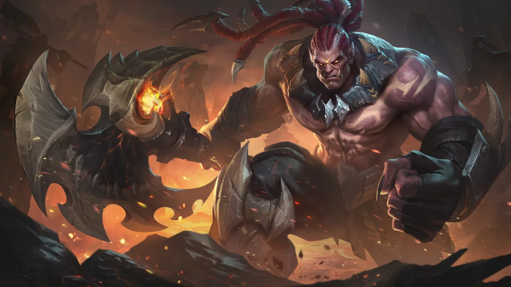

[All skins](https://boostmlbb.ru/en/skins/)

[Skins](https://boostmlbb.ru/en/skins/)/Balmond

# Balmond skins

Skins

9

In the shop

5

Latest

[Razor Edge](https://boostmlbb.ru/en/skins/balmond/razor-edge.html)2025

[Hero profile→](https://boostmlbb.ru/en/heroes/balmond.html)

## All skins

AllExquisiteDeluxeExceptionalCommon

[Razor EdgeExceptional · 2025](https://boostmlbb.ru/en/skins/balmond/razor-edge.html)[Infernal WarlordDeluxe · 2023](https://boostmlbb.ru/en/skins/balmond/infernal-warlord.html)[BioroidExceptional · 2022](https://boostmlbb.ru/en/skins/balmond/bioroid.html)[God of MountainsExquisite · 2021](https://boostmlbb.ru/en/skins/balmond/god-of-mountains.html)[Savage PointguardExceptional · 2018](https://boostmlbb.ru/en/skins/balmond/savage-pointguard.html)[Savage HunterCommon · 2017](https://boostmlbb.ru/en/skins/balmond/savage-hunter.html)[Ghoul's FuryCommon · 2016](https://boostmlbb.ru/en/skins/balmond/ghoul-s-fury.html)[Power SourceCommon · 2016](https://boostmlbb.ru/en/skins/balmond/power-source.html)[Ironhide BerserkerCommon](https://boostmlbb.ru/en/skins/balmond/ironhide-berserker.html)

**How much is a rank boost on Balmond?**Choose your current and target ranks to see the price here.

[Calculate price](https://boostmlbb.ru/en/order.html?type=hero)

## Frequently asked questions

How many skins does Balmond have?

9 skins, the default look not counted. The newest is Razor Edge (6 January 2025).

Which Balmond skins can you buy now?

Infernal Warlord (899 diamonds), Savage Pointguard (749 diamonds), Savage Hunter (599 diamonds), Ghoul's Fury (399 diamonds), Power Source (269 diamonds). The other skins were limited and come back only in events.

What is the rarest Balmond skin?

God of Mountains, Exquisite class, Collector series. The top prize of a Collector event draw, paid with diamonds. Limited skins come back in event draws from time to time.
