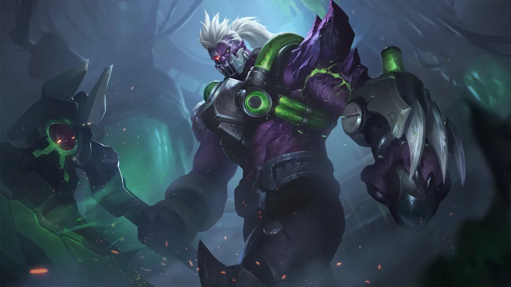
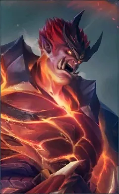

[Balmond skins](https://boostmlbb.ru/en/skins/balmond.html)

[Skins](https://boostmlbb.ru/en/skins/)/[Balmond](https://boostmlbb.ru/en/skins/balmond.html)/Bioroid

[Balmond skin](https://boostmlbb.ru/en/skins/balmond.html)

# Bioroid

ExceptionalStarLightLimited

How to get

StarLight reward for April 2022.

Released

1 April 2022

## What the skin changes

-   New look
-   New skill effects
-   Showcase animation
-   Showcase scene
-   Attribute bonus

## All Balmond skins [9](https://boostmlbb.ru/en/skins/balmond.html)

[Razor EdgeExceptional · 2025](https://boostmlbb.ru/en/skins/balmond/razor-edge.html)[Infernal WarlordDeluxe · 2023](https://boostmlbb.ru/en/skins/balmond/infernal-warlord.html)[BioroidExceptional · 2022](https://boostmlbb.ru/en/skins/balmond/bioroid.html)[God of MountainsExquisite · 2021](https://boostmlbb.ru/en/skins/balmond/god-of-mountains.html)[Savage PointguardExceptional · 2018](https://boostmlbb.ru/en/skins/balmond/savage-pointguard.html)[Savage HunterCommon · 2017](https://boostmlbb.ru/en/skins/balmond/savage-hunter.html)[Ghoul's FuryCommon · 2016](https://boostmlbb.ru/en/skins/balmond/ghoul-s-fury.html)[Power SourceCommon · 2016](https://boostmlbb.ru/en/skins/balmond/power-source.html)[Ironhide BerserkerCommon](https://boostmlbb.ru/en/skins/balmond/ironhide-berserker.html)

## StarLight series

[Tideborn SailorKalea · 2026](https://boostmlbb.ru/en/skins/kalea/tideborn-sailor.html)[Kitsune's ShadowHayabusa · 2026](https://boostmlbb.ru/en/skins/hayabusa/kitsune-s-shadow.html)[Fangs of SlaughterHanzo · 2026](https://boostmlbb.ru/en/skins/hanzo/fangs-of-slaughter.html)[Smoul­dering FortressBelerick · 2026](https://boostmlbb.ru/en/skins/belerick/smouldering-fortress.html)[Magitech WraithObsidia · 2026](https://boostmlbb.ru/en/skins/obsidia/magitech-wraith.html)[Elysian LuminanceZetian · 2026](https://boostmlbb.ru/en/skins/zetian/elysian-luminance.html)[Guardian BattalionHilda · 2026](https://boostmlbb.ru/en/skins/hilda/guardian-battalion.html)[Dreaming KoiHarley · 2026](https://boostmlbb.ru/en/skins/harley/dreaming-koi.html)

**How much is a rank boost on Balmond?**Choose your current and target ranks to see the price here.

[Calculate price](https://boostmlbb.ru/en/order.html?type=hero)

## Frequently asked questions

How to get the Bioroid skin for Balmond?

StarLight reward for April 2022.

When was Bioroid released?

1 April 2022.

What class is Bioroid?

Exceptional, StarLight series.
