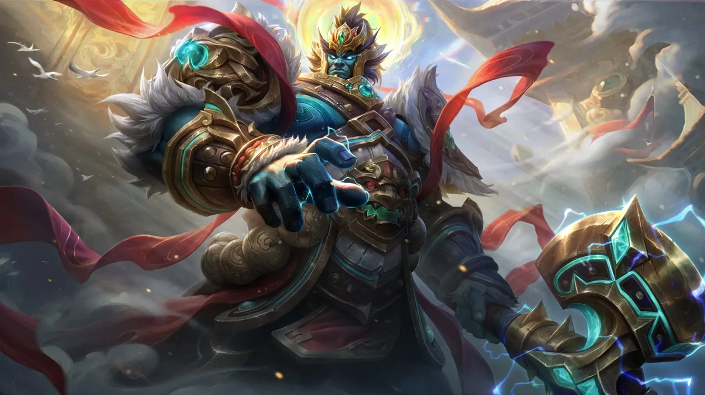

[Tier list](https://boostmlbb.ru/en/heroes/)[Items](https://boostmlbb.ru/en/items/)[Skins](https://boostmlbb.ru/en/skins/)[News & guides](https://boostmlbb.ru/en/news/)

[Skins](https://boostmlbb.ru/en/skins/)/[Balmond](https://boostmlbb.ru/en/skins/balmond.html)/God of Mountains

[Balmond skin](https://boostmlbb.ru/en/skins/balmond.html)

# God of Mountains

ExquisiteCollectorLimited

How to get

The top prize of a Collector event draw, paid with diamonds. Limited skins come back in event draws from time to time.

Released

August 2021

## What the skin changes

-   New look
-   New skill effects
-   Skill sounds
-   Voice-over
-   Showcase animation
-   Showcase scene
-   Attribute bonus

## All Balmond skins [9](https://boostmlbb.ru/en/skins/balmond.html)

[Razor EdgeExceptional · 2025](https://boostmlbb.ru/en/skins/balmond/razor-edge.html)[Infernal WarlordDeluxe · 2023](https://boostmlbb.ru/en/skins/balmond/infernal-warlord.html)[BioroidExceptional · 2022](https://boostmlbb.ru/en/skins/balmond/bioroid.html)[God of MountainsExquisite · 2021](https://boostmlbb.ru/en/skins/balmond/god-of-mountains.html)[Savage PointguardExceptional · 2018](https://boostmlbb.ru/en/skins/balmond/savage-pointguard.html)[Savage HunterCommon · 2017](https://boostmlbb.ru/en/skins/balmond/savage-hunter.html)[Ghoul's FuryCommon · 2016](https://boostmlbb.ru/en/skins/balmond/ghoul-s-fury.html)[Power SourceCommon · 2016](https://boostmlbb.ru/en/skins/balmond/power-source.html)[Ironhide BerserkerCommon](https://boostmlbb.ru/en/skins/balmond/ironhide-berserker.html)

## Collector series

[The PurifierBruno · 2026](https://boostmlbb.ru/en/skins/bruno/the-purifier.html)[Celestial RebelSun · 2026](https://boostmlbb.ru/en/skins/sun/celestial-rebel.html)[Kaiju of the DeepHelcurt · 2026](https://boostmlbb.ru/en/skins/helcurt/kaiju-of-the-deep.html)[Starbound SentryKimmy · 2026](https://boostmlbb.ru/en/skins/kimmy/starbound-sentry.html)[Dreaming MonarchAlice · 2026](https://boostmlbb.ru/en/skins/alice/dreaming-monarch.html)[Tremor of the DeepGrock · 2026](https://boostmlbb.ru/en/skins/grock/tremor-of-the-deep.html)[Celestial GeneralTigreal · 2026](https://boostmlbb.ru/en/skins/tigreal/celestial-general.html)[Sunborn MonarchXavier · 2026](https://boostmlbb.ru/en/skins/xavier/sunborn-monarch.html)

**Rank up on Balmond**The calculator shows the price

[Calculate price](https://boostmlbb.ru/en/order.html?type=hero)

## Frequently asked questions

How to get the God of Mountains skin for Balmond?

The top prize of a Collector event draw, paid with diamonds. Limited skins come back in event draws from time to time.

When was God of Mountains released?

August 2021.

What class is God of Mountains?

Exquisite, Collector series.
