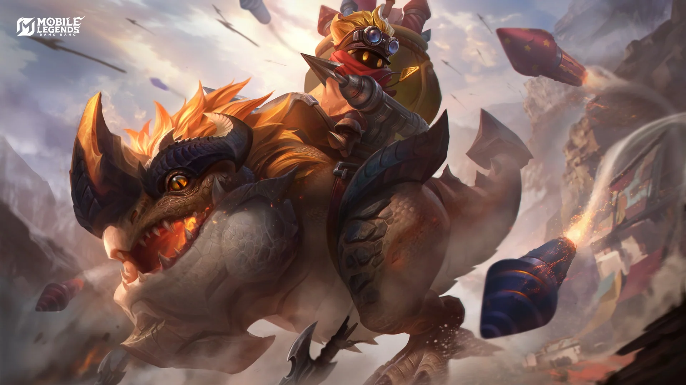

[Tier list](https://boostmlbb.ru/en/heroes/)[Items](https://boostmlbb.ru/en/items/)[Skins](https://boostmlbb.ru/en/skins/)[News & guides](https://boostmlbb.ru/en/news/)

[Skins](https://boostmlbb.ru/en/skins/)/Barats

# Barats skins

Skins

5

In the shop

4

Latest

[Sunken Predator](https://boostmlbb.ru/en/skins/barats/sunken-predator.html)2025

[Hero profile→](https://boostmlbb.ru/en/heroes/barats.html)

## All skins

[Sunken PredatorDeluxe · 2025](https://boostmlbb.ru/en/skins/barats/sunken-predator.html)[War ChiefCommon · 2022](https://boostmlbb.ru/en/skins/barats/war-chief.html)[BaratsteinExceptional · 2021](https://boostmlbb.ru/en/skins/barats/baratstein.html)[Toy RexCommon · 2021](https://boostmlbb.ru/en/skins/barats/toy-rex.html)[Armored LizardCommon · 2020](https://boostmlbb.ru/en/skins/barats/armored-lizard.html)

**Rank up on Barats**The calculator shows the price

[Calculate price](https://boostmlbb.ru/en/order.html?type=hero)

## Frequently asked questions

How many skins does Barats have?

5 skins, the default look not counted. The newest is Sunken Predator (10 February 2025).

Which Barats skins can you buy now?

Sunken Predator (899 diamonds), Baratstein (749 diamonds), Toy Rex (599 diamonds), Armored Lizard (269 diamonds). The other skins were limited and come back only in events.

What is the rarest Barats skin?

Sunken Predator, Deluxe class, Epic series. Sold in the skin shop for 899 diamonds.
