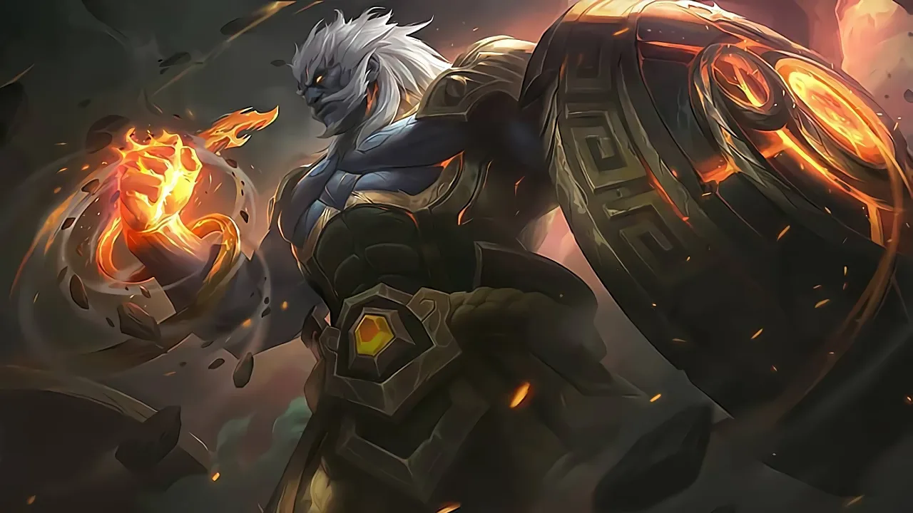

[All skins](https://boostmlbb.ru/en/skins/)

[Skins](https://boostmlbb.ru/en/skins/)/Baxia

# Baxia skins

Skins

6

In the shop

3

Latest

[Dauntless Shield](https://boostmlbb.ru/en/skins/baxia/dauntless-shield.html)2024

[Hero profile→](https://boostmlbb.ru/en/heroes/baxia.html)

## All skins

[Dauntless ShieldExceptional · 2024](https://boostmlbb.ru/en/skins/baxia/dauntless-shield.html)[Black TortoiseCommon · 2023](https://boostmlbb.ru/en/skins/baxia/black-tortoise.html)[Ba-tenderExceptional · 2021](https://boostmlbb.ru/en/skins/baxia/ba-tender.html)[Badass RollerCommon · 2020](https://boostmlbb.ru/en/skins/baxia/badass-roller.html)[Wild TotemCommon · 2019](https://boostmlbb.ru/en/skins/baxia/wild-totem.html)[Aegis of Honor](https://boostmlbb.ru/en/skins/baxia/aegis-of-honor.html)

**How much is a rank boost on Baxia?**Choose your current and target ranks to see the price here.

[Calculate price](https://boostmlbb.ru/en/order.html?type=hero)

## Frequently asked questions

How many skins does Baxia have?

6 skins, the default look not counted. The newest is Dauntless Shield (18 November 2024).

Which Baxia skins can you buy now?

Ba-tender (749 diamonds), Badass Roller (599 diamonds), Wild Totem (269 diamonds). The other skins were limited and come back only in events.

What is the rarest Baxia skin?

Dauntless Shield, Exceptional class, Special series. M6 Pass reward.
