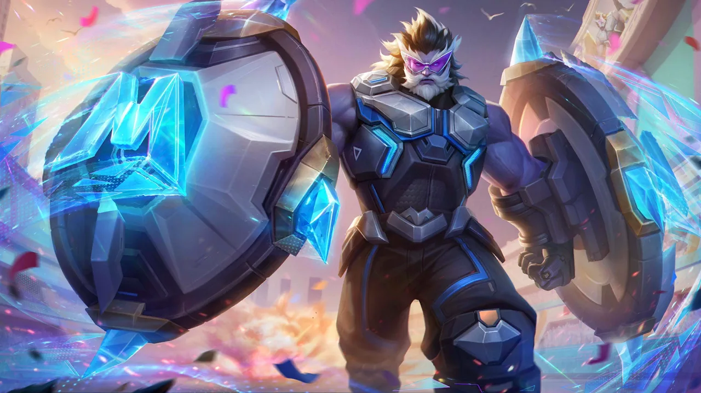
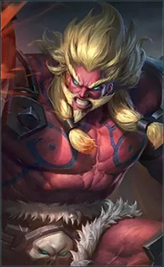

[Baxia skins](https://boostmlbb.ru/en/skins/baxia.html)

[Skins](https://boostmlbb.ru/en/skins/)/[Baxia](https://boostmlbb.ru/en/skins/baxia.html)/Dauntless Shield

[Baxia skin](https://boostmlbb.ru/en/skins/baxia.html)

# Dauntless Shield

ExceptionalSpecialLimited

How to get

M6 Pass reward.

Released

18 November 2024

## What the skin changes

-   New look
-   New skill effects
-   Showcase animation
-   Attribute bonus

## All Baxia skins [6](https://boostmlbb.ru/en/skins/baxia.html)

[Dauntless ShieldExceptional · 2024](https://boostmlbb.ru/en/skins/baxia/dauntless-shield.html)[Black TortoiseCommon · 2023](https://boostmlbb.ru/en/skins/baxia/black-tortoise.html)[Ba-tenderExceptional · 2021](https://boostmlbb.ru/en/skins/baxia/ba-tender.html)[Badass RollerCommon · 2020](https://boostmlbb.ru/en/skins/baxia/badass-roller.html)[Wild TotemCommon · 2019](https://boostmlbb.ru/en/skins/baxia/wild-totem.html)[Aegis of Honor](https://boostmlbb.ru/en/skins/baxia/aegis-of-honor.html)

## Special series

[Arcane VerdictMathilda · 2026](https://boostmlbb.ru/en/skins/mathilda/arcane-verdict.html)[Windborne WaltzVale · 2026](https://boostmlbb.ru/en/skins/vale/windborne-waltz.html)[Captain of the LostFranco · 2026](https://boostmlbb.ru/en/skins/franco/captain-of-the-lost.html)[Waveb­reakerYi Sun-shin · 2025](https://boostmlbb.ru/en/skins/yi-sun-shin/wavebreaker.html)[Steel ArmsBadang · 2025](https://boostmlbb.ru/en/skins/badang/steel-arms.html)[Lady ParasolKagura · 2025](https://boostmlbb.ru/en/skins/kagura/lady-parasol.html)[Fathom TerrorAldous · 2025](https://boostmlbb.ru/en/skins/aldous/fathom-terror.html)[Moonglow TroupeChang'e · 2025](https://boostmlbb.ru/en/skins/change/moonglow-troupe.html)

**How much is a rank boost on Baxia?**Choose your current and target ranks to see the price here.

[Calculate price](https://boostmlbb.ru/en/order.html?type=hero)

## Frequently asked questions

How to get the Dauntless Shield skin for Baxia?

M6 Pass reward.

When was Dauntless Shield released?

18 November 2024.

What class is Dauntless Shield?

Exceptional, Special series.
