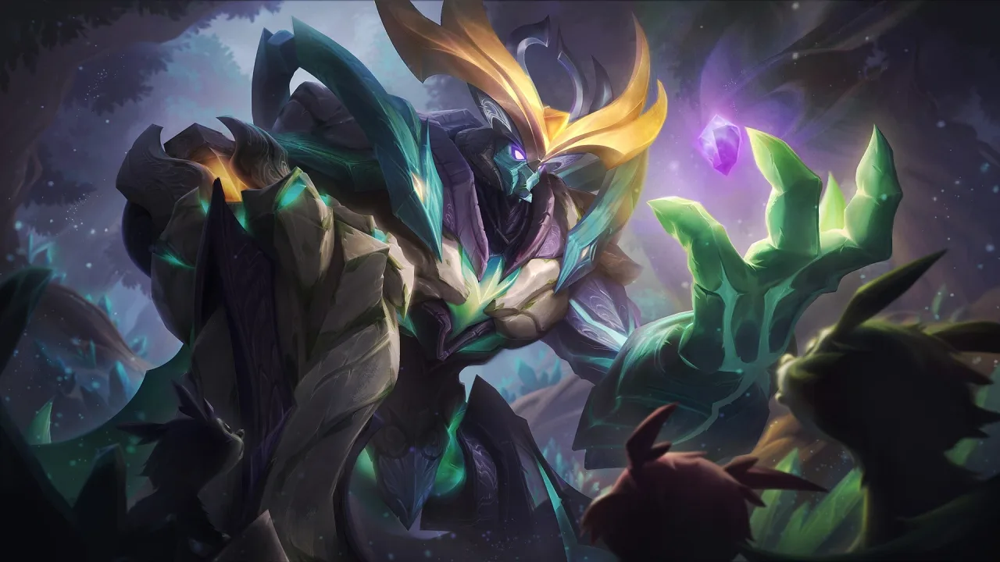

[Belerick skins](https://boostmlbb.ru/en/skins/belerick.html)

[Skins](https://boostmlbb.ru/en/skins/)/[Belerick](https://boostmlbb.ru/en/skins/belerick.html)/Emerald Guardian

[Belerick skin](https://boostmlbb.ru/en/skins/belerick.html)

# Emerald Guardian

ExceptionalSpecialLimited

How to get

M3 Pass reward.

Released

22 November 2018

## What the skin changes

-   New look
-   New skill effects
-   Showcase animation
-   Attribute bonus

## All Belerick skins [6](https://boostmlbb.ru/en/skins/belerick.html)

[Smoul­dering FortressExceptional · 2026](https://boostmlbb.ru/en/skins/belerick/smouldering-fortress.html)[Arbiter of StarsDeluxe · 2025](https://boostmlbb.ru/en/skins/belerick/arbiter-of-stars.html)[Tiger's ClawCommon · 2022](https://boostmlbb.ru/en/skins/belerick/tiger-s-claw.html)[Torch GuardianCommon · 2019](https://boostmlbb.ru/en/skins/belerick/torch-guardian.html)[Emerald GuardianExceptional · 2018](https://boostmlbb.ru/en/skins/belerick/emerald-guardian.html)[The Deep OneExceptional · 2018](https://boostmlbb.ru/en/skins/belerick/the-deep-one.html)

## Special series

[Arcane VerdictMathilda · 2026](https://boostmlbb.ru/en/skins/mathilda/arcane-verdict.html)[Windborne WaltzVale · 2026](https://boostmlbb.ru/en/skins/vale/windborne-waltz.html)[Captain of the LostFranco · 2026](https://boostmlbb.ru/en/skins/franco/captain-of-the-lost.html)[Waveb­reakerYi Sun-shin · 2025](https://boostmlbb.ru/en/skins/yi-sun-shin/wavebreaker.html)[Steel ArmsBadang · 2025](https://boostmlbb.ru/en/skins/badang/steel-arms.html)[Lady ParasolKagura · 2025](https://boostmlbb.ru/en/skins/kagura/lady-parasol.html)[Fathom TerrorAldous · 2025](https://boostmlbb.ru/en/skins/aldous/fathom-terror.html)[Moonglow TroupeChang'e · 2025](https://boostmlbb.ru/en/skins/change/moonglow-troupe.html)

**How much is a rank boost on Belerick?**Choose your current and target ranks to see the price here.

[Calculate price](https://boostmlbb.ru/en/order.html?type=hero)

## Frequently asked questions

How to get the Emerald Guardian skin for Belerick?

M3 Pass reward.

When was Emerald Guardian released?

22 November 2018.

What class is Emerald Guardian?

Exceptional, Special series.
