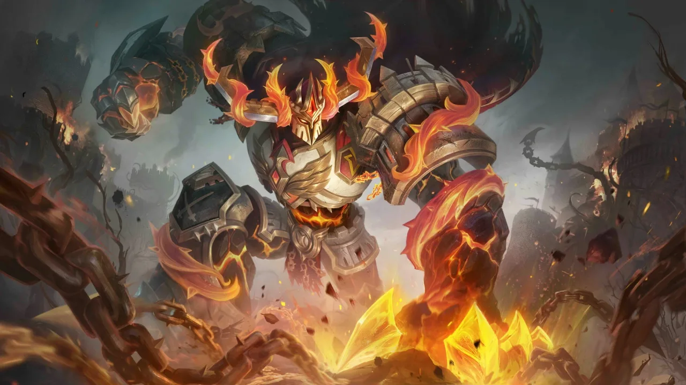
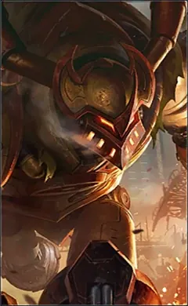

[Belerick skins](https://boostmlbb.ru/en/skins/belerick.html)

[Skins](https://boostmlbb.ru/en/skins/)/[Belerick](https://boostmlbb.ru/en/skins/belerick.html)/Smouldering Fortress

[Belerick skin](https://boostmlbb.ru/en/skins/belerick.html)

# Smouldering Fortress

ExceptionalStarLightLimited

How to get

StarLight reward for July 2026.

Released

1 July 2026

## All Belerick skins [6](https://boostmlbb.ru/en/skins/belerick.html)

[Smoul­dering FortressExceptional · 2026](https://boostmlbb.ru/en/skins/belerick/smouldering-fortress.html)[Arbiter of StarsDeluxe · 2025](https://boostmlbb.ru/en/skins/belerick/arbiter-of-stars.html)[Tiger's ClawCommon · 2022](https://boostmlbb.ru/en/skins/belerick/tiger-s-claw.html)[Torch GuardianCommon · 2019](https://boostmlbb.ru/en/skins/belerick/torch-guardian.html)[Emerald GuardianExceptional · 2018](https://boostmlbb.ru/en/skins/belerick/emerald-guardian.html)[The Deep OneExceptional · 2018](https://boostmlbb.ru/en/skins/belerick/the-deep-one.html)

## StarLight series

[Tideborn SailorKalea · 2026](https://boostmlbb.ru/en/skins/kalea/tideborn-sailor.html)[Kitsune's ShadowHayabusa · 2026](https://boostmlbb.ru/en/skins/hayabusa/kitsune-s-shadow.html)[Fangs of SlaughterHanzo · 2026](https://boostmlbb.ru/en/skins/hanzo/fangs-of-slaughter.html)[Magitech WraithObsidia · 2026](https://boostmlbb.ru/en/skins/obsidia/magitech-wraith.html)[Elysian LuminanceZetian · 2026](https://boostmlbb.ru/en/skins/zetian/elysian-luminance.html)[Guardian BattalionHilda · 2026](https://boostmlbb.ru/en/skins/hilda/guardian-battalion.html)[Dreaming KoiHarley · 2026](https://boostmlbb.ru/en/skins/harley/dreaming-koi.html)[Royal MarshalFredrinn · 2025](https://boostmlbb.ru/en/skins/fredrinn/royal-marshal.html)

**How much is a rank boost on Belerick?**Choose your current and target ranks to see the price here.

[Calculate price](https://boostmlbb.ru/en/order.html?type=hero)

## Frequently asked questions

How to get the Smouldering Fortress skin for Belerick?

StarLight reward for July 2026.

When was Smouldering Fortress released?

1 July 2026.

What class is Smouldering Fortress?

Exceptional, StarLight series.
