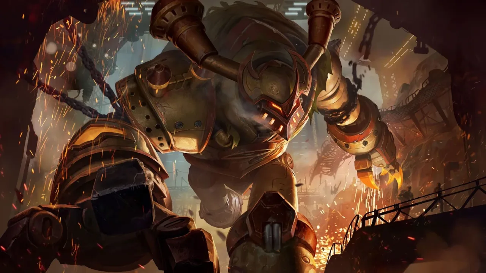

[Belerick skins](https://boostmlbb.ru/en/skins/belerick.html)

[Skins](https://boostmlbb.ru/en/skins/)/[Belerick](https://boostmlbb.ru/en/skins/belerick.html)/Torch Guardian

[Belerick skin](https://boostmlbb.ru/en/skins/belerick.html)

# Torch Guardian

CommonEliteLimited

How to get

Released in the skin shop during an event. Limited skins come back in event draws from time to time.

Released

1 August 2019

## What the skin changes

-   New look
-   Recoloured effects
-   Showcase animation
-   Attribute bonus

## All Belerick skins [6](https://boostmlbb.ru/en/skins/belerick.html)

[Smoul­dering FortressExceptional · 2026](https://boostmlbb.ru/en/skins/belerick/smouldering-fortress.html)[Arbiter of StarsDeluxe · 2025](https://boostmlbb.ru/en/skins/belerick/arbiter-of-stars.html)[Tiger's ClawCommon · 2022](https://boostmlbb.ru/en/skins/belerick/tiger-s-claw.html)[Torch GuardianCommon · 2019](https://boostmlbb.ru/en/skins/belerick/torch-guardian.html)[Emerald GuardianExceptional · 2018](https://boostmlbb.ru/en/skins/belerick/emerald-guardian.html)[The Deep OneExceptional · 2018](https://boostmlbb.ru/en/skins/belerick/the-deep-one.html)

## Elite series

[Golden OsmanthusChang'e · 2026](https://boostmlbb.ru/en/skins/change/golden-osmanthus.html)[Warlord KingMartis · 2025](https://boostmlbb.ru/en/skins/martis/warlord-king.html)[High Seas CadetKimmy · 2024](https://boostmlbb.ru/en/skins/kimmy/high-seas-cadet.html)[Verdant LancerSilvanna · 2024](https://boostmlbb.ru/en/skins/silvanna/verdant-lancer.html)[Bloodhoof MarauderHylos · 2024](https://boostmlbb.ru/en/skins/hylos/bloodhoof-marauder.html)[Elegant ButterflyGuinevere · 2024](https://boostmlbb.ru/en/skins/guinevere/elegant-butterfly.html)[Marques of BladesLancelot · 2024](https://boostmlbb.ru/en/skins/lancelot/marques-of-blades.html)[Badlands HiatusChip · 2024](https://boostmlbb.ru/en/skins/chip/badlands-hiatus.html)

**How much is a rank boost on Belerick?**Choose your current and target ranks to see the price here.

[Calculate price](https://boostmlbb.ru/en/order.html?type=hero)

## Frequently asked questions

How to get the Torch Guardian skin for Belerick?

Released in the skin shop during an event. Limited skins come back in event draws from time to time.

When was Torch Guardian released?

1 August 2019.

What class is Torch Guardian?

Common, Elite series.
