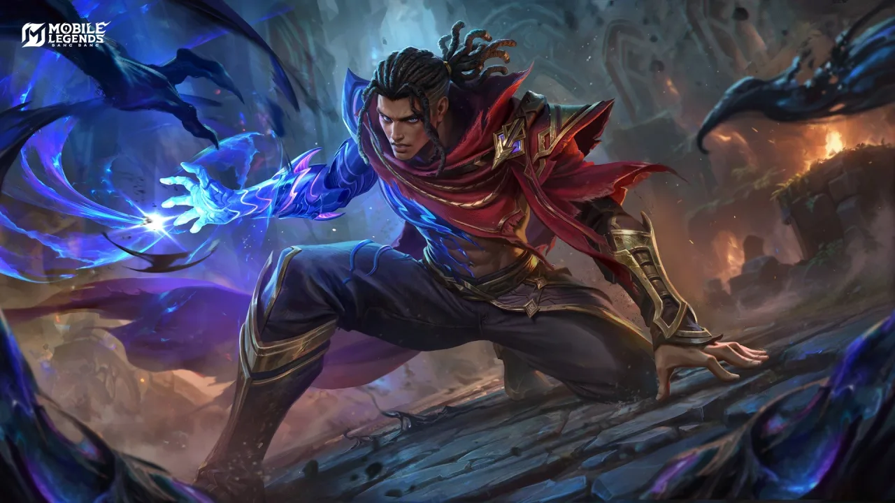

[Tier list](https://boostmlbb.ru/en/heroes/)[Items](https://boostmlbb.ru/en/items/)[Skins](https://boostmlbb.ru/en/skins/)[News & guides](https://boostmlbb.ru/en/news/)

[Skins](https://boostmlbb.ru/en/skins/)/Brody

# Brody skins

Skins

7

In the shop

2

Latest

[Neobeast Brody](https://boostmlbb.ru/en/skins/brody/neobeast-brody.html)2025

[Hero profile→](https://boostmlbb.ru/en/heroes/brody.html)

## All skins

AllGrandExquisiteDeluxeExceptionalCommon

[Neobeast BrodyGrand · 2025](https://boostmlbb.ru/en/skins/brody/neobeast-brody.html)[APBrenDeluxe · 2024](https://boostmlbb.ru/en/skins/brody/apbren.html)[Quantum GripExceptional · 2023](https://boostmlbb.ru/en/skins/brody/quantum-grip.html)[Ore-chemistExquisite · 2022](https://boostmlbb.ru/en/skins/brody/ore-chemist.html)[Lethal FangExceptional · 2021](https://boostmlbb.ru/en/skins/brody/lethal-fang.html)[S.T.U.N. BrodyDeluxe · 2021](https://boostmlbb.ru/en/skins/brody/s-t-u-n-brody.html)[Nameless StrayCommon · 2020](https://boostmlbb.ru/en/skins/brody/nameless-stray.html)

**Rank up on Brody**The calculator shows the price

[Calculate price](https://boostmlbb.ru/en/order.html?type=hero)

## Frequently asked questions

How many skins does Brody have?

7 skins, the default look not counted. The newest is Neobeast Brody (12 April 2025).

Which Brody skins can you buy now?

Quantum Grip (749 diamonds), Nameless Stray (269 diamonds). The other skins were limited and come back only in events.

What is the rarest Brody skin?

Neobeast Brody, Grand class, Neobeast 2 series. Released in the Neobeast 2 event. Limited skins come back in event draws from time to time.
