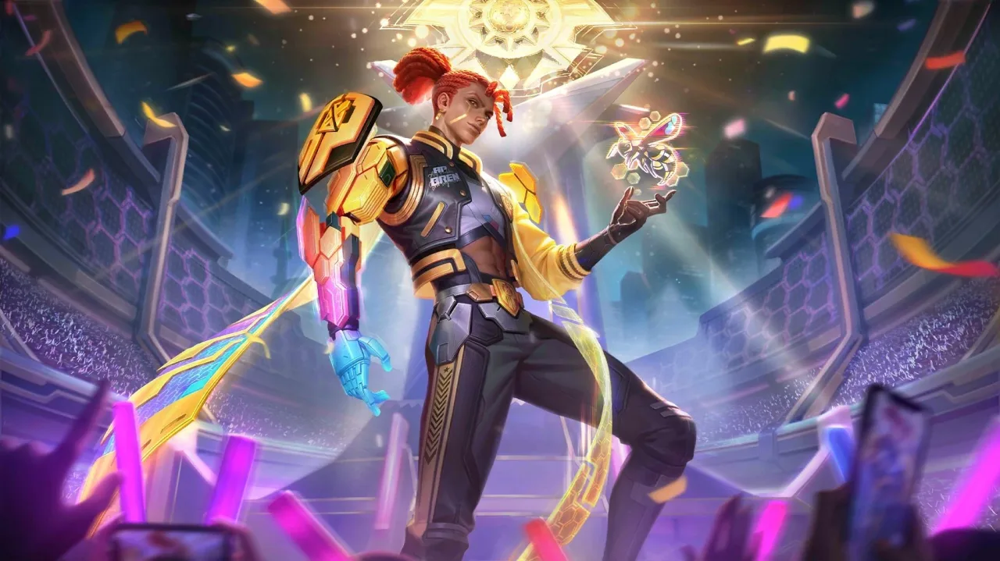

[Tier list](https://boostmlbb.ru/en/heroes/)[Items](https://boostmlbb.ru/en/items/)[Skins](https://boostmlbb.ru/en/skins/)[News & guides](https://boostmlbb.ru/en/news/)

[Skins](https://boostmlbb.ru/en/skins/)/[Brody](https://boostmlbb.ru/en/skins/brody.html)/APBren

[Brody skin](https://boostmlbb.ru/en/skins/brody.html)

# APBren

DeluxeChampionLimited

How to get

Esports skin of Champion: it was released in the tournament event. Limited skins come back in event draws from time to time.

Released

19 September 2024

## What the skin changes

-   New look
-   New skill effects
-   Skill sounds
-   Voice-over
-   Showcase animation
-   Showcase scene
-   Showcase music
-   Attribute bonus

## All Brody skins [7](https://boostmlbb.ru/en/skins/brody.html)

[Neobeast BrodyGrand · 2025](https://boostmlbb.ru/en/skins/brody/neobeast-brody.html)[APBrenDeluxe · 2024](https://boostmlbb.ru/en/skins/brody/apbren.html)[Quantum GripExceptional · 2023](https://boostmlbb.ru/en/skins/brody/quantum-grip.html)[Ore-chemistExquisite · 2022](https://boostmlbb.ru/en/skins/brody/ore-chemist.html)[Lethal FangExceptional · 2021](https://boostmlbb.ru/en/skins/brody/lethal-fang.html)[S.T.U.N. BrodyDeluxe · 2021](https://boostmlbb.ru/en/skins/brody/s-t-u-n-brody.html)[Nameless StrayCommon · 2020](https://boostmlbb.ru/en/skins/brody/nameless-stray.html)

## Champion series

[EVOS LegendsHarith · 2025](https://boostmlbb.ru/en/skins/harith/evos-legends.html)[Blacklist Interna­tionalEstes · 2024](https://boostmlbb.ru/en/skins/estes/blacklist-international.html)[ECHOChou · 2023](https://boostmlbb.ru/en/skins/chou/echo.html)[Bren EsportsLancelot · 2020](https://boostmlbb.ru/en/skins/lancelot/bren-esports.html)

**Rank up on Brody**The calculator shows the price

[Calculate price](https://boostmlbb.ru/en/order.html?type=hero)

## Frequently asked questions

How to get the APBren skin for Brody?

Esports skin of Champion: it was released in the tournament event. Limited skins come back in event draws from time to time.

When was APBren released?

19 September 2024.

What class is APBren?

Deluxe, Champion series.
