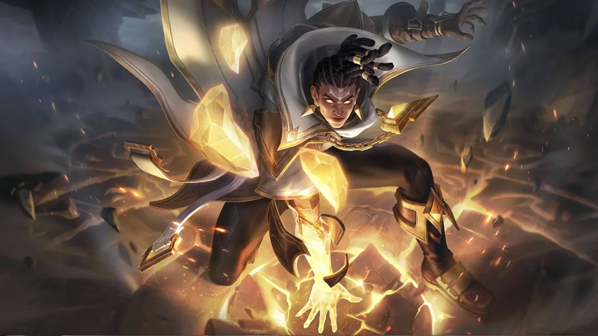

[Brody skins](https://boostmlbb.ru/en/skins/brody.html)

[Skins](https://boostmlbb.ru/en/skins/)/[Brody](https://boostmlbb.ru/en/skins/brody.html)/Ore-chemist

[Brody skin](https://boostmlbb.ru/en/skins/brody.html)

# Ore-chemist

ExquisiteCollectorLimited

How to get

The top prize of a Collector event draw, paid with diamonds. Limited skins come back in event draws from time to time.

Released

7 April 2022

## What the skin changes

-   New look
-   New skill effects
-   Skill sounds
-   Voice-over
-   Showcase animation
-   Showcase scene
-   Showcase music
-   Special actions
-   Attribute bonus

## All Brody skins [7](https://boostmlbb.ru/en/skins/brody.html)

[Neobeast BrodyGrand · 2025](https://boostmlbb.ru/en/skins/brody/neobeast-brody.html)[APBrenDeluxe · 2024](https://boostmlbb.ru/en/skins/brody/apbren.html)[Quantum GripExceptional · 2023](https://boostmlbb.ru/en/skins/brody/quantum-grip.html)[Ore-chemistExquisite · 2022](https://boostmlbb.ru/en/skins/brody/ore-chemist.html)[Lethal FangExceptional · 2021](https://boostmlbb.ru/en/skins/brody/lethal-fang.html)[S.T.U.N. BrodyDeluxe · 2021](https://boostmlbb.ru/en/skins/brody/s-t-u-n-brody.html)[Nameless StrayCommon · 2020](https://boostmlbb.ru/en/skins/brody/nameless-stray.html)

## Collector series

[The PurifierBruno · 2026](https://boostmlbb.ru/en/skins/bruno/the-purifier.html)[Celestial RebelSun · 2026](https://boostmlbb.ru/en/skins/sun/celestial-rebel.html)[Kaiju of the DeepHelcurt · 2026](https://boostmlbb.ru/en/skins/helcurt/kaiju-of-the-deep.html)[Starbound SentryKimmy · 2026](https://boostmlbb.ru/en/skins/kimmy/starbound-sentry.html)[Dreaming MonarchAlice · 2026](https://boostmlbb.ru/en/skins/alice/dreaming-monarch.html)[Tremor of the DeepGrock · 2026](https://boostmlbb.ru/en/skins/grock/tremor-of-the-deep.html)[Celestial GeneralTigreal · 2026](https://boostmlbb.ru/en/skins/tigreal/celestial-general.html)[Sunborn MonarchXavier · 2026](https://boostmlbb.ru/en/skins/xavier/sunborn-monarch.html)

**How much is a rank boost on Brody?**Choose your current and target ranks to see the price here.

[Calculate price](https://boostmlbb.ru/en/order.html?type=hero)

## Frequently asked questions

How to get the Ore-chemist skin for Brody?

The top prize of a Collector event draw, paid with diamonds. Limited skins come back in event draws from time to time.

When was Ore-chemist released?

7 April 2022.

What class is Ore-chemist?

Exquisite, Collector series.
