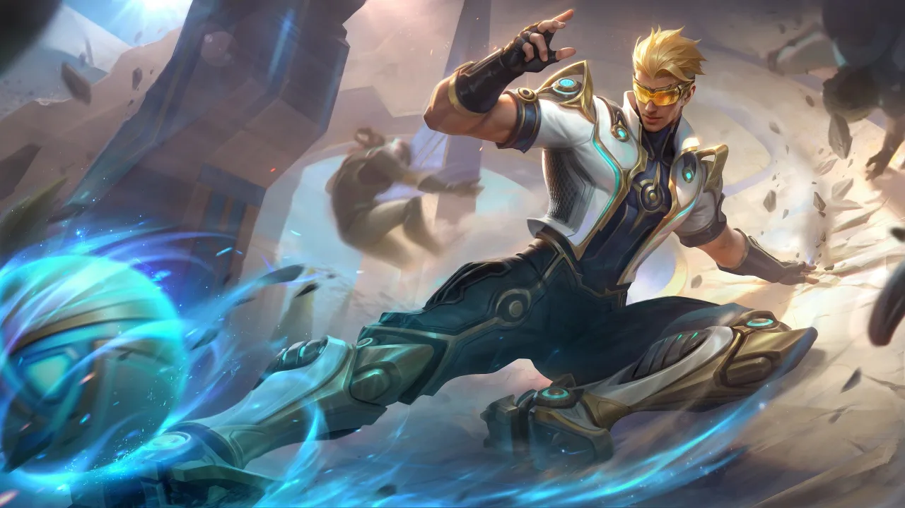
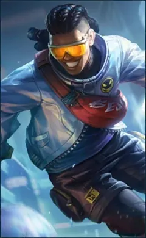
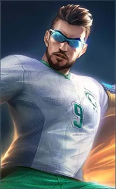

[Tier list](https://boostmlbb.ru/en/heroes/)[Items](https://boostmlbb.ru/en/items/)[Skins](https://boostmlbb.ru/en/skins/)[News & guides](https://boostmlbb.ru/en/news/)

[Skins](https://boostmlbb.ru/en/skins/)/Bruno

# Bruno skins

Skins

9

In the shop

4

Latest

[The Purifier](https://boostmlbb.ru/en/skins/bruno/the-purifier.html)2026

[Hero profile→](https://boostmlbb.ru/en/heroes/bruno.html)

## All skins

AllGrandExquisiteDeluxeExceptionalCommon

[The PurifierExquisite · 2026](https://boostmlbb.ru/en/skins/bruno/the-purifier.html)[Street HypeExceptional · 2024](https://boostmlbb.ru/en/skins/bruno/street-hype.html)[Neymar JrExceptional · 2022](https://boostmlbb.ru/en/skins/bruno/neymar-jr.html)[Halo StrikerDeluxe · 2022](https://boostmlbb.ru/en/skins/bruno/halo-striker.html)[FireboltGrand · 2020](https://boostmlbb.ru/en/skins/bruno/firebolt.html)[The FalconExceptional · 2020](https://boostmlbb.ru/en/skins/bruno/the-falcon.html)[Street FootballCommon · 2018](https://boostmlbb.ru/en/skins/bruno/street-football.html)[Best DJExceptional · 2016](https://boostmlbb.ru/en/skins/bruno/best-dj.html)[Vanguard EliteCommon · 2016](https://boostmlbb.ru/en/skins/bruno/vanguard-elite.html)

**Rank up on Bruno**The calculator shows the price

[Calculate price](https://boostmlbb.ru/en/order.html?type=hero)

## Frequently asked questions

How many skins does Bruno have?

9 skins, the default look not counted. The newest is The Purifier (November 2026).

Which Bruno skins can you buy now?

The Falcon (749 diamonds), Street Football (599 diamonds), Best DJ (749 diamonds), Vanguard Elite (399 diamonds). The other skins were limited and come back only in events.

What is the rarest Bruno skin?

Firebolt, Grand class, Dawning Stars series. Released in the Dawning Stars event. Limited skins come back in event draws from time to time.
