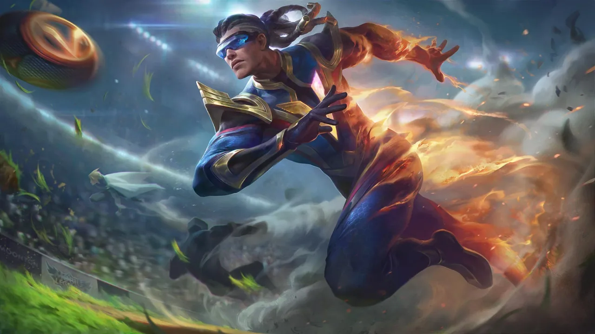
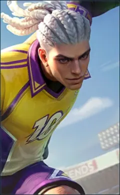

[Tier list](https://boostmlbb.ru/en/heroes/)[Items](https://boostmlbb.ru/en/items/)[Skins](https://boostmlbb.ru/en/skins/)[News & guides](https://boostmlbb.ru/en/news/)

[Skins](https://boostmlbb.ru/en/skins/)/[Bruno](https://boostmlbb.ru/en/skins/bruno.html)/Firebolt

[Bruno skin](https://boostmlbb.ru/en/skins/bruno.html)

# Firebolt

GrandDawning StarsLimited

How to get

Released in the Dawning Stars event. Limited skins come back in event draws from time to time.

Released

2020

## What the skin changes

-   New look
-   New skill effects
-   Skill sounds
-   Voice-over
-   Showcase animation
-   Showcase scene
-   Attribute bonus

## All Bruno skins [9](https://boostmlbb.ru/en/skins/bruno.html)

[The PurifierExquisite · 2026](https://boostmlbb.ru/en/skins/bruno/the-purifier.html)[Street HypeExceptional · 2024](https://boostmlbb.ru/en/skins/bruno/street-hype.html)[Neymar JrExceptional · 2022](https://boostmlbb.ru/en/skins/bruno/neymar-jr.html)[Halo StrikerDeluxe · 2022](https://boostmlbb.ru/en/skins/bruno/halo-striker.html)[FireboltGrand · 2020](https://boostmlbb.ru/en/skins/bruno/firebolt.html)[The FalconExceptional · 2020](https://boostmlbb.ru/en/skins/bruno/the-falcon.html)[Street FootballCommon · 2018](https://boostmlbb.ru/en/skins/bruno/street-football.html)[Best DJExceptional · 2016](https://boostmlbb.ru/en/skins/bruno/best-dj.html)[Vanguard EliteCommon · 2016](https://boostmlbb.ru/en/skins/bruno/vanguard-elite.html)

## Dawning Stars series

[SwordmasterLancelot · 2024](https://boostmlbb.ru/en/skins/lancelot/swordmaster.html)[Blizzard StormVale · 2023](https://boostmlbb.ru/en/skins/vale/blizzard-storm.html)[The ForeseerEsmeralda · 2023](https://boostmlbb.ru/en/skins/esmeralda/the-foreseer.html)[Thun­derfistChou · 2021](https://boostmlbb.ru/en/skins/chou/thunderfist.html)

**Rank up on Bruno**The calculator shows the price

[Calculate price](https://boostmlbb.ru/en/order.html?type=hero)

## Frequently asked questions

How to get the Firebolt skin for Bruno?

Released in the Dawning Stars event. Limited skins come back in event draws from time to time.

When was Firebolt released?

2020.

What class is Firebolt?

Grand, Dawning Stars series.
