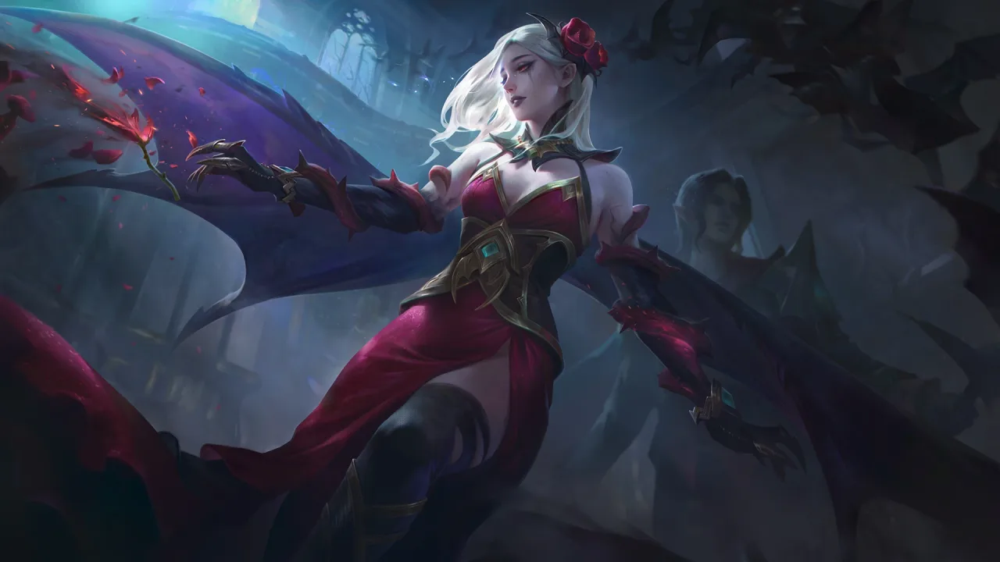

[All skins](https://boostmlbb.ru/en/skins/)

[Skins](https://boostmlbb.ru/en/skins/)/Carmilla

# Carmilla skins

Skins

4

In the shop

4

Latest

[Astral Arcana](https://boostmlbb.ru/en/skins/carmilla/astral-arcana.html)2024

[Hero profile→](https://boostmlbb.ru/en/heroes/carmilla.html)

## All skins

[Astral ArcanaDeluxe · 2024](https://boostmlbb.ru/en/skins/carmilla/astral-arcana.html)[Phantom CountessExceptional · 2021](https://boostmlbb.ru/en/skins/carmilla/phantom-countess.html)[Magician GirlCommon · 2020](https://boostmlbb.ru/en/skins/carmilla/magician-girl.html)[Wisteria CountessCommon · 2020](https://boostmlbb.ru/en/skins/carmilla/wisteria-countess.html)

**How much is a rank boost on Carmilla?**Choose your current and target ranks to see the price here.

[Calculate price](https://boostmlbb.ru/en/order.html?type=hero)

## Frequently asked questions

How many skins does Carmilla have?

4 skins, the default look not counted. The newest is Astral Arcana (26 July 2024).

Which Carmilla skins can you buy now?

Astral Arcana (899 diamonds), Phantom Countess (749 diamonds), Magician Girl (599 diamonds), Wisteria Countess (269 diamonds). The other skins were limited and come back only in events.

What is the rarest Carmilla skin?

Astral Arcana, Deluxe class, Epic series. Sold in the skin shop for 899 diamonds.
