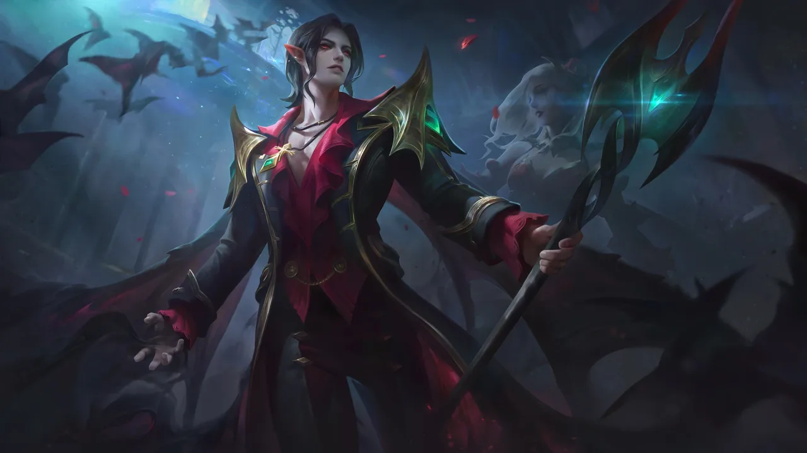
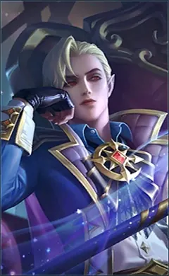

[Tier list](https://boostmlbb.ru/en/heroes/)[Items](https://boostmlbb.ru/en/items/)[Skins](https://boostmlbb.ru/en/skins/)[News & guides](https://boostmlbb.ru/en/news/)

[Skins](https://boostmlbb.ru/en/skins/)/Cecilion

# Cecilion skins

Skins

6

In the shop

3

Latest

[Hisoka](https://boostmlbb.ru/en/skins/cecilion/hisoka.html)2025

[Hero profile→](https://boostmlbb.ru/en/heroes/cecilion.html)

## All skins

[HisokaGrand · 2025](https://boostmlbb.ru/en/skins/cecilion/hisoka.html)[Crimson WingsExquisite · 2022](https://boostmlbb.ru/en/skins/cecilion/crimson-wings.html)[StargazerExceptional · 2022](https://boostmlbb.ru/en/skins/cecilion/stargazer.html)[Phantom CountExceptional · 2021](https://boostmlbb.ru/en/skins/cecilion/phantom-count.html)[The Illu­sionistCommon · 2020](https://boostmlbb.ru/en/skins/cecilion/the-illusionist.html)[Wisteria CountCommon · 2020](https://boostmlbb.ru/en/skins/cecilion/wisteria-count.html)

**Rank up on Cecilion**The calculator shows the price

[Calculate price](https://boostmlbb.ru/en/order.html?type=hero)

## Frequently asked questions

How many skins does Cecilion have?

6 skins, the default look not counted. The newest is Hisoka (14 January 2025).

Which Cecilion skins can you buy now?

Phantom Count (749 diamonds), The Illusionist (599 diamonds), Wisteria Count (269 diamonds). The other skins were limited and come back only in events.

What is the rarest Cecilion skin?

Hisoka, Grand class, HUNTER×HUNTER series. Released in the MLBB × HUNTER×HUNTER collaboration event. Limited skins come back in event draws from time to time.
