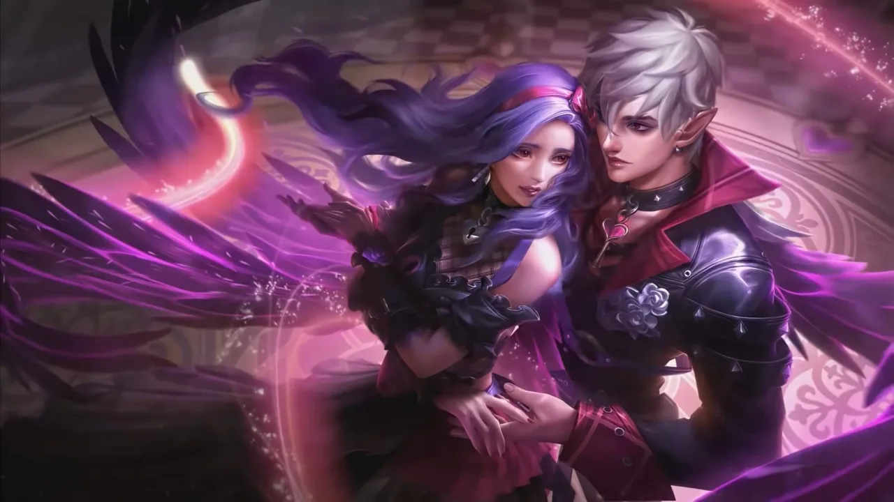

[Tier list](https://boostmlbb.ru/en/heroes/)[Items](https://boostmlbb.ru/en/items/)[Skins](https://boostmlbb.ru/en/skins/)[News & guides](https://boostmlbb.ru/en/news/)

[Skins](https://boostmlbb.ru/en/skins/)/[Cecilion](https://boostmlbb.ru/en/skins/cecilion.html)/Phantom Count

[Cecilion skin](https://boostmlbb.ru/en/skins/cecilion.html)

# Phantom Count

ExceptionalValentineIn the shop

How to get

Sold in the skin shop for 749 diamonds.

Price

749 diamonds

Released

14 February 2021

## What the skin changes

-   New look
-   New skill effects
-   Showcase animation
-   Attribute bonus

## All Cecilion skins [6](https://boostmlbb.ru/en/skins/cecilion.html)

[HisokaGrand · 2025](https://boostmlbb.ru/en/skins/cecilion/hisoka.html)[Crimson WingsExquisite · 2022](https://boostmlbb.ru/en/skins/cecilion/crimson-wings.html)[StargazerExceptional · 2022](https://boostmlbb.ru/en/skins/cecilion/stargazer.html)[Phantom CountExceptional · 2021](https://boostmlbb.ru/en/skins/cecilion/phantom-count.html)[The Illu­sionistCommon · 2020](https://boostmlbb.ru/en/skins/cecilion/the-illusionist.html)[Wisteria CountCommon · 2020](https://boostmlbb.ru/en/skins/cecilion/wisteria-count.html)

## Valentine series

[Heart AflameClaude · 2024](https://boostmlbb.ru/en/skins/claude/heart-aflame.html)[Alluring EnigmaGranger · 2024](https://boostmlbb.ru/en/skins/granger/alluring-enigma.html)[Alluring MystiqueSilvanna · 2024](https://boostmlbb.ru/en/skins/silvanna/alluring-mystique.html)[Gentleman ThiefKhufra · 2023](https://boostmlbb.ru/en/skins/khufra/gentleman-thief.html)[Heart AfloatFanny · 2022](https://boostmlbb.ru/en/skins/fanny/heart-afloat.html)[Phantom CountessCarmilla · 2021](https://boostmlbb.ru/en/skins/carmilla/phantom-countess.html)[Lady ThiefEsmeralda · 2020](https://boostmlbb.ru/en/skins/esmeralda/lady-thief.html)[Dangerous LoveLesley · 2019](https://boostmlbb.ru/en/skins/lesley/dangerous-love.html)

**Rank up on Cecilion**The calculator shows the price

[Calculate price](https://boostmlbb.ru/en/order.html?type=hero)

## Frequently asked questions

How to get the Phantom Count skin for Cecilion?

Sold in the skin shop for 749 diamonds.

When was Phantom Count released?

14 February 2021.

What class is Phantom Count?

Exceptional, Valentine series.
