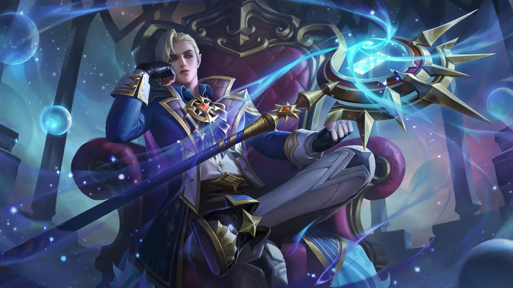
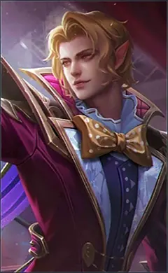

[Cecilion skins](https://boostmlbb.ru/en/skins/cecilion.html)

[Skins](https://boostmlbb.ru/en/skins/)/[Cecilion](https://boostmlbb.ru/en/skins/cecilion.html)/Stargazer

[Cecilion skin](https://boostmlbb.ru/en/skins/cecilion.html)

# Stargazer

ExceptionalStarLightLimited

How to get

StarLight reward for February 2022.

Released

1 February 2022

## What the skin changes

-   New look
-   New skill effects
-   Showcase animation
-   Showcase scene
-   Attribute bonus

## All Cecilion skins [6](https://boostmlbb.ru/en/skins/cecilion.html)

[HisokaGrand · 2025](https://boostmlbb.ru/en/skins/cecilion/hisoka.html)[Crimson WingsExquisite · 2022](https://boostmlbb.ru/en/skins/cecilion/crimson-wings.html)[StargazerExceptional · 2022](https://boostmlbb.ru/en/skins/cecilion/stargazer.html)[Phantom CountExceptional · 2021](https://boostmlbb.ru/en/skins/cecilion/phantom-count.html)[The Illu­sionistCommon · 2020](https://boostmlbb.ru/en/skins/cecilion/the-illusionist.html)[Wisteria CountCommon · 2020](https://boostmlbb.ru/en/skins/cecilion/wisteria-count.html)

## StarLight series

[Tideborn SailorKalea · 2026](https://boostmlbb.ru/en/skins/kalea/tideborn-sailor.html)[Kitsune's ShadowHayabusa · 2026](https://boostmlbb.ru/en/skins/hayabusa/kitsune-s-shadow.html)[Fangs of SlaughterHanzo · 2026](https://boostmlbb.ru/en/skins/hanzo/fangs-of-slaughter.html)[Smoul­dering FortressBelerick · 2026](https://boostmlbb.ru/en/skins/belerick/smouldering-fortress.html)[Magitech WraithObsidia · 2026](https://boostmlbb.ru/en/skins/obsidia/magitech-wraith.html)[Elysian LuminanceZetian · 2026](https://boostmlbb.ru/en/skins/zetian/elysian-luminance.html)[Guardian BattalionHilda · 2026](https://boostmlbb.ru/en/skins/hilda/guardian-battalion.html)[Dreaming KoiHarley · 2026](https://boostmlbb.ru/en/skins/harley/dreaming-koi.html)

**How much is a rank boost on Cecilion?**Choose your current and target ranks to see the price here.

[Calculate price](https://boostmlbb.ru/en/order.html?type=hero)

## Frequently asked questions

How to get the Stargazer skin for Cecilion?

StarLight reward for February 2022.

When was Stargazer released?

1 February 2022.

What class is Stargazer?

Exceptional, StarLight series.
