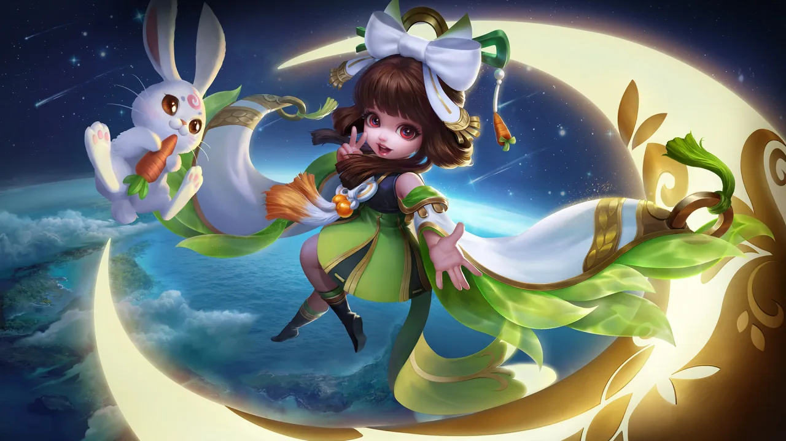

[All skins](https://boostmlbb.ru/en/skins/)

[Skins](https://boostmlbb.ru/en/skins/)/Chang'e

# Chang'e skins

Skins

11

In the shop

4

Latest

[Golden Osmanthus](https://boostmlbb.ru/en/skins/change/golden-osmanthus.html)2026

[Hero profile→](https://boostmlbb.ru/en/heroes/change.html)

## All skins

AllGrandExquisiteDeluxeExceptionalCommon

[Golden OsmanthusCommon · 2026](https://boostmlbb.ru/en/skins/change/golden-osmanthus.html)[Moonglow TroupeExceptional · 2025](https://boostmlbb.ru/en/skins/change/moonglow-troupe.html)[Tech TensaiGrand · 2024](https://boostmlbb.ru/en/skins/change/tech-tensai.html)[New MoonDeluxe · 2023](https://boostmlbb.ru/en/skins/change/new-moon.html)[Moon ArtistGrand · 2022](https://boostmlbb.ru/en/skins/change/moon-artist.html)[Vine CradleDeluxe · 2021](https://boostmlbb.ru/en/skins/change/vine-cradle.html)[Strawberry ParfaitExceptional · 2020](https://boostmlbb.ru/en/skins/change/strawberry-parfait.html)[Lunar MagicExquisite · 2020](https://boostmlbb.ru/en/skins/change/lunar-magic.html)[Floral ElfoExceptional · 2019](https://boostmlbb.ru/en/skins/change/floral-elfo.html)[Crimson MoonCommon · 2019](https://boostmlbb.ru/en/skins/change/crimson-moon.html)[MoonstruckCommon · 2018](https://boostmlbb.ru/en/skins/change/moonstruck.html)

**How much is a rank boost on Chang'e?**Choose your current and target ranks to see the price here.

[Calculate price](https://boostmlbb.ru/en/order.html?type=hero)

## Frequently asked questions

How many skins does Chang'e have?

11 skins, the default look not counted. The newest is Golden Osmanthus (25 September 2026).

Which Chang'e skins can you buy now?

Vine Cradle (899 diamonds), Floral Elfo (749 diamonds), Crimson Moon (599 diamonds), Moonstruck (269 diamonds). The other skins were limited and come back only in events.

What is the rarest Chang'e skin?

Tech Tensai, Grand class, The Aspirants series. Released in the The Aspirants event. Limited skins come back in event draws from time to time.
