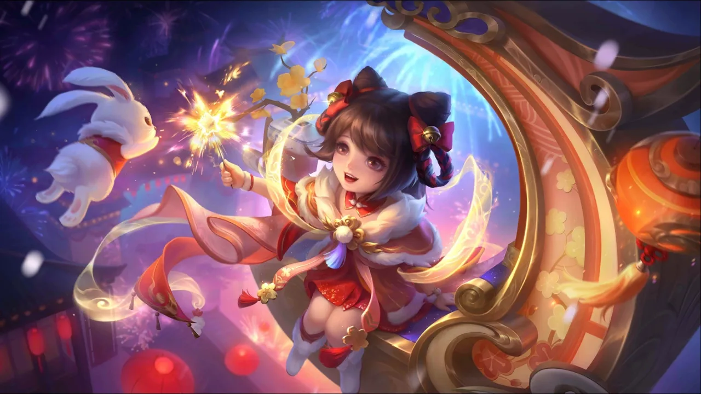

[Chang'e skins](https://boostmlbb.ru/en/skins/change.html)

[Skins](https://boostmlbb.ru/en/skins/)/[Chang'e](https://boostmlbb.ru/en/skins/change.html)/New Moon

[Chang'e skin](https://boostmlbb.ru/en/skins/change.html)

# New Moon

DeluxeLunar FestivalLimited

How to get

Released in the skin shop during an event. Limited skins come back in event draws from time to time.

Released

18 January 2023

## What the skin changes

-   New look
-   New skill effects
-   Skill sounds
-   Voice-over
-   Showcase animation
-   Showcase scene
-   Showcase music
-   Spawn animation
-   Special actions
-   Attribute bonus

## All Chang'e skins [11](https://boostmlbb.ru/en/skins/change.html)

[Golden OsmanthusCommon · 2026](https://boostmlbb.ru/en/skins/change/golden-osmanthus.html)[Moonglow TroupeExceptional · 2025](https://boostmlbb.ru/en/skins/change/moonglow-troupe.html)[Tech TensaiGrand · 2024](https://boostmlbb.ru/en/skins/change/tech-tensai.html)[New MoonDeluxe · 2023](https://boostmlbb.ru/en/skins/change/new-moon.html)[Moon ArtistGrand · 2022](https://boostmlbb.ru/en/skins/change/moon-artist.html)[Vine CradleDeluxe · 2021](https://boostmlbb.ru/en/skins/change/vine-cradle.html)[Strawberry ParfaitExceptional · 2020](https://boostmlbb.ru/en/skins/change/strawberry-parfait.html)[Lunar MagicExquisite · 2020](https://boostmlbb.ru/en/skins/change/lunar-magic.html)[Floral ElfoExceptional · 2019](https://boostmlbb.ru/en/skins/change/floral-elfo.html)[Crimson MoonCommon · 2019](https://boostmlbb.ru/en/skins/change/crimson-moon.html)[MoonstruckCommon · 2018](https://boostmlbb.ru/en/skins/change/moonstruck.html)

## Lunar Festival series

[Auspicious BlazeLeomord · 2026](https://boostmlbb.ru/en/skins/leomord/auspicious-blaze.html)[Bloom of AbundanceRafaela · 2025](https://boostmlbb.ru/en/skins/rafaela/bloom-of-abundance.html)[Dragon of ProsperityZilong · 2024](https://boostmlbb.ru/en/skins/zilong/dragon-of-prosperity.html)[Spring BlessingsSun · 2022](https://boostmlbb.ru/en/skins/sun/spring-blessings.html)[Dawning FortuneLuo Yi · 2021](https://boostmlbb.ru/en/skins/luo-yi/dawning-fortune.html)[Auspicious CharmOdette · 2019](https://boostmlbb.ru/en/skins/odette/auspicious-charm.html)[Lion DanceLolita · 2019](https://boostmlbb.ru/en/skins/lolita/lion-dance.html)[Foxy LadyAurora · 2018](https://boostmlbb.ru/en/skins/aurora/foxy-lady.html)

**How much is a rank boost on Chang'e?**Choose your current and target ranks to see the price here.

[Calculate price](https://boostmlbb.ru/en/order.html?type=hero)

## Frequently asked questions

How to get the New Moon skin for Chang'e?

Released in the skin shop during an event. Limited skins come back in event draws from time to time.

When was New Moon released?

18 January 2023.

What class is New Moon?

Deluxe, Lunar Festival series.
