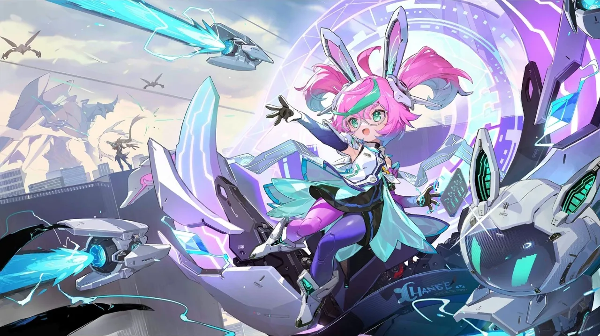

[Tier list](https://boostmlbb.ru/en/heroes/)[Items](https://boostmlbb.ru/en/items/)[Skins](https://boostmlbb.ru/en/skins/)[News & guides](https://boostmlbb.ru/en/news/)

[Skins](https://boostmlbb.ru/en/skins/)/[Chang'e](https://boostmlbb.ru/en/skins/change.html)/Tech Tensai

[Chang'e skin](https://boostmlbb.ru/en/skins/change.html)

# Tech Tensai

GrandThe AspirantsLimited

How to get

Released in the The Aspirants event. Limited skins come back in event draws from time to time.

Released

5 March 2024

## What the skin changes

-   New look
-   New skill effects
-   Skill sounds
-   Voice-over
-   Showcase animation
-   Showcase scene
-   Showcase music
-   Spawn animation
-   Special actions
-   Attribute bonus

## All Chang'e skins [11](https://boostmlbb.ru/en/skins/change.html)

[Golden OsmanthusCommon · 2026](https://boostmlbb.ru/en/skins/change/golden-osmanthus.html)[Moonglow TroupeExceptional · 2025](https://boostmlbb.ru/en/skins/change/moonglow-troupe.html)[Tech TensaiGrand · 2024](https://boostmlbb.ru/en/skins/change/tech-tensai.html)[New MoonDeluxe · 2023](https://boostmlbb.ru/en/skins/change/new-moon.html)[Moon ArtistGrand · 2022](https://boostmlbb.ru/en/skins/change/moon-artist.html)[Vine CradleDeluxe · 2021](https://boostmlbb.ru/en/skins/change/vine-cradle.html)[Strawberry ParfaitExceptional · 2020](https://boostmlbb.ru/en/skins/change/strawberry-parfait.html)[Lunar MagicExquisite · 2020](https://boostmlbb.ru/en/skins/change/lunar-magic.html)[Floral ElfoExceptional · 2019](https://boostmlbb.ru/en/skins/change/floral-elfo.html)[Crimson MoonCommon · 2019](https://boostmlbb.ru/en/skins/change/crimson-moon.html)[MoonstruckCommon · 2018](https://boostmlbb.ru/en/skins/change/moonstruck.html)

## The Aspirants series

[Silverbolt RaikoSelena · 2026](https://boostmlbb.ru/en/skins/selena/silverbolt-raiko.html)[Imperatrix ArashiObsidia · 2026](https://boostmlbb.ru/en/skins/obsidia/imperatrix-arashi.html)[Daybreak HaloGuinevere · 2025](https://boostmlbb.ru/en/skins/guinevere/daybreak-halo.html)[Twilight StarVexana · 2025](https://boostmlbb.ru/en/skins/vexana/twilight-star.html)[Deadeye SpectreLesley · 2024](https://boostmlbb.ru/en/skins/lesley/deadeye-spectre.html)[Mecha MaidenRuby · 2023](https://boostmlbb.ru/en/skins/ruby/mecha-maiden.html)[Blade of KibouFanny · 2022](https://boostmlbb.ru/en/skins/fanny/blade-of-kibou.html)[Miss HikariLayla · 2022](https://boostmlbb.ru/en/skins/layla/miss-hikari.html)

**Rank up on Chang'e**The calculator shows the price

[Calculate price](https://boostmlbb.ru/en/order.html?type=hero)

## Frequently asked questions

How to get the Tech Tensai skin for Chang'e?

Released in the The Aspirants event. Limited skins come back in event draws from time to time.

When was Tech Tensai released?

5 March 2024.

What class is Tech Tensai?

Grand, The Aspirants series.
