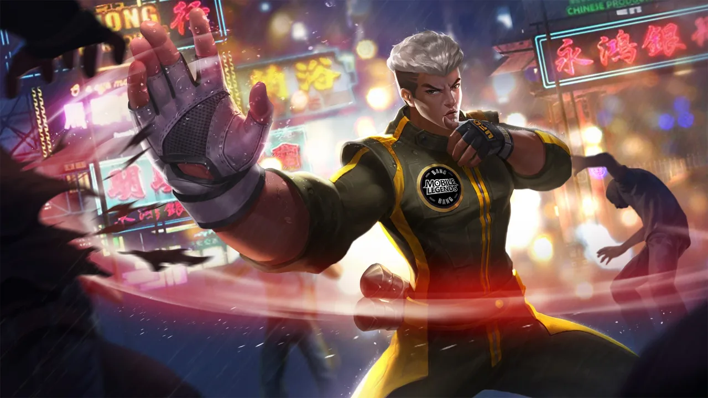

[Tier list](https://boostmlbb.ru/en/heroes/)[Items](https://boostmlbb.ru/en/items/)[Skins](https://boostmlbb.ru/en/skins/)[News & guides](https://boostmlbb.ru/en/news/)

[Skins](https://boostmlbb.ru/en/skins/)/Chou

# Chou skins

Skins

11

In the shop

3

Latest

[ECHO](https://boostmlbb.ru/en/skins/chou/echo.html)2023

[Hero profile→](https://boostmlbb.ru/en/heroes/chou.html)

## All skins

AllGrandExquisiteDeluxeExceptionalCommon

[ECHODeluxe · 2023](https://boostmlbb.ru/en/skins/chou/echo.html)[Dragon ShiryuDeluxe · 2022](https://boostmlbb.ru/en/skins/chou/dragon-shiryu.html)[Libra ShiryuGrand · 2022](https://boostmlbb.ru/en/skins/chou/libra-shiryu.html)[S.T.U.N. ChouDeluxe · 2021](https://boostmlbb.ru/en/skins/chou/s-t-u-n-chou.html)[Thun­derfistGrand · 2021](https://boostmlbb.ru/en/skins/chou/thunderfist.html)[Go BallisticExceptional · 2019](https://boostmlbb.ru/en/skins/chou/go-ballistic.html)[Iori YagamiGrand · 2019](https://boostmlbb.ru/en/skins/chou/iori-yagami.html)[Furious TigerExceptional · 2018](https://boostmlbb.ru/en/skins/chou/furious-tiger.html)[King of Muay ThaiCommon · 2017](https://boostmlbb.ru/en/skins/chou/king-of-muay-thai.html)[Dragon BoyExquisite · 2017](https://boostmlbb.ru/en/skins/chou/dragon-boy.html)[Hip-hop BoyCommon · 2016](https://boostmlbb.ru/en/skins/chou/hip-hop-boy.html)

**Rank up on Chou**The calculator shows the price

[Calculate price](https://boostmlbb.ru/en/order.html?type=hero)

## Frequently asked questions

How many skins does Chou have?

11 skins, the default look not counted. The newest is ECHO (14 August 2023).

Which Chou skins can you buy now?

Furious Tiger (749 diamonds), King of Muay Thai (599 diamonds), Hip-hop Boy (269 diamonds). The other skins were limited and come back only in events.

What is the rarest Chou skin?

Libra Shiryu, Grand class, Saint Seiya series. Released in the MLBB × Saint Seiya event.
