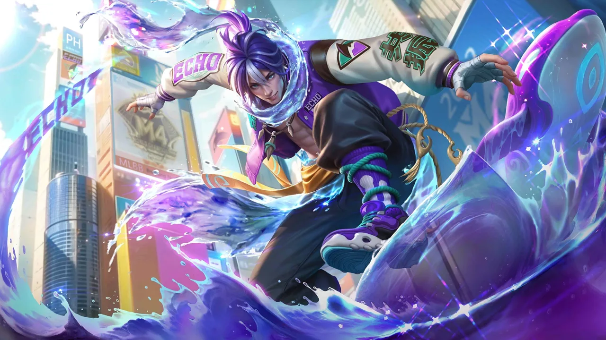

[Chou skins](https://boostmlbb.ru/en/skins/chou.html)

[Skins](https://boostmlbb.ru/en/skins/)/[Chou](https://boostmlbb.ru/en/skins/chou.html)/ECHO

[Chou skin](https://boostmlbb.ru/en/skins/chou.html)

# ECHO

DeluxeChampionLimited

How to get

Price at release: 899 diamonds. Not sold in the shop now: it comes back only in events.

Price

899 diamonds

Released

14 August 2023

## What the skin changes

-   New look
-   New skill effects
-   Skill sounds
-   Showcase animation
-   Showcase scene
-   Showcase music
-   Attribute bonus

## All Chou skins [11](https://boostmlbb.ru/en/skins/chou.html)

[ECHODeluxe · 2023](https://boostmlbb.ru/en/skins/chou/echo.html)[Dragon ShiryuDeluxe · 2022](https://boostmlbb.ru/en/skins/chou/dragon-shiryu.html)[Libra ShiryuGrand · 2022](https://boostmlbb.ru/en/skins/chou/libra-shiryu.html)[S.T.U.N. ChouDeluxe · 2021](https://boostmlbb.ru/en/skins/chou/s-t-u-n-chou.html)[Thun­derfistGrand · 2021](https://boostmlbb.ru/en/skins/chou/thunderfist.html)[Go BallisticExceptional · 2019](https://boostmlbb.ru/en/skins/chou/go-ballistic.html)[Iori YagamiGrand · 2019](https://boostmlbb.ru/en/skins/chou/iori-yagami.html)[Furious TigerExceptional · 2018](https://boostmlbb.ru/en/skins/chou/furious-tiger.html)[King of Muay ThaiCommon · 2017](https://boostmlbb.ru/en/skins/chou/king-of-muay-thai.html)[Dragon BoyExquisite · 2017](https://boostmlbb.ru/en/skins/chou/dragon-boy.html)[Hip-hop BoyCommon · 2016](https://boostmlbb.ru/en/skins/chou/hip-hop-boy.html)

## Champion series

[EVOS LegendsHarith · 2025](https://boostmlbb.ru/en/skins/harith/evos-legends.html)[APBrenBrody · 2024](https://boostmlbb.ru/en/skins/brody/apbren.html)[Blacklist Interna­tionalEstes · 2024](https://boostmlbb.ru/en/skins/estes/blacklist-international.html)[Bren EsportsLancelot · 2020](https://boostmlbb.ru/en/skins/lancelot/bren-esports.html)

**How much is a rank boost on Chou?**Choose your current and target ranks to see the price here.

[Calculate price](https://boostmlbb.ru/en/order.html?type=hero)

## Frequently asked questions

How to get the ECHO skin for Chou?

Price at release: 899 diamonds. Not sold in the shop now: it comes back only in events.

When was ECHO released?

14 August 2023.

What class is ECHO?

Deluxe, Champion series.
