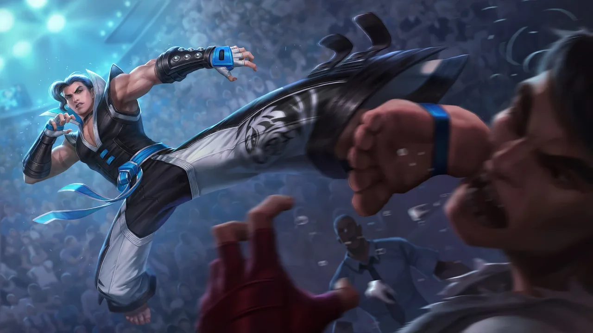

[Tier list](https://boostmlbb.ru/en/heroes/)[Items](https://boostmlbb.ru/en/items/)[Skins](https://boostmlbb.ru/en/skins/)[News & guides](https://boostmlbb.ru/en/news/)

[Skins](https://boostmlbb.ru/en/skins/)/[Chou](https://boostmlbb.ru/en/skins/chou.html)/Furious Tiger

[Chou skin](https://boostmlbb.ru/en/skins/chou.html)

# Furious Tiger

ExceptionalSpecialIn the shop

How to get

Sold in the skin shop for 749 diamonds.

Price

749 diamonds

Released

2018

## What the skin changes

-   New look
-   New skill effects
-   Showcase animation
-   Attribute bonus

## Painted versions

The same skin in other colours. A painted version needs the skin itself.

-   **Red Tiger**

## All Chou skins [11](https://boostmlbb.ru/en/skins/chou.html)

[ECHODeluxe · 2023](https://boostmlbb.ru/en/skins/chou/echo.html)[Dragon ShiryuDeluxe · 2022](https://boostmlbb.ru/en/skins/chou/dragon-shiryu.html)[Libra ShiryuGrand · 2022](https://boostmlbb.ru/en/skins/chou/libra-shiryu.html)[S.T.U.N. ChouDeluxe · 2021](https://boostmlbb.ru/en/skins/chou/s-t-u-n-chou.html)[Thun­derfistGrand · 2021](https://boostmlbb.ru/en/skins/chou/thunderfist.html)[Go BallisticExceptional · 2019](https://boostmlbb.ru/en/skins/chou/go-ballistic.html)[Iori YagamiGrand · 2019](https://boostmlbb.ru/en/skins/chou/iori-yagami.html)[Furious TigerExceptional · 2018](https://boostmlbb.ru/en/skins/chou/furious-tiger.html)[King of Muay ThaiCommon · 2017](https://boostmlbb.ru/en/skins/chou/king-of-muay-thai.html)[Dragon BoyExquisite · 2017](https://boostmlbb.ru/en/skins/chou/dragon-boy.html)[Hip-hop BoyCommon · 2016](https://boostmlbb.ru/en/skins/chou/hip-hop-boy.html)

## Special series

[Arcane VerdictMathilda · 2026](https://boostmlbb.ru/en/skins/mathilda/arcane-verdict.html)[Windborne WaltzVale · 2026](https://boostmlbb.ru/en/skins/vale/windborne-waltz.html)[Captain of the LostFranco · 2026](https://boostmlbb.ru/en/skins/franco/captain-of-the-lost.html)[Waveb­reakerYi Sun-shin · 2025](https://boostmlbb.ru/en/skins/yi-sun-shin/wavebreaker.html)[Steel ArmsBadang · 2025](https://boostmlbb.ru/en/skins/badang/steel-arms.html)[Lady ParasolKagura · 2025](https://boostmlbb.ru/en/skins/kagura/lady-parasol.html)[Fathom TerrorAldous · 2025](https://boostmlbb.ru/en/skins/aldous/fathom-terror.html)[Moonglow TroupeChang'e · 2025](https://boostmlbb.ru/en/skins/change/moonglow-troupe.html)

**Rank up on Chou**The calculator shows the price

[Calculate price](https://boostmlbb.ru/en/order.html?type=hero)

## Frequently asked questions

How to get the Furious Tiger skin for Chou?

Sold in the skin shop for 749 diamonds.

When was Furious Tiger released?

2018.

What class is Furious Tiger?

Exceptional, Special series.
