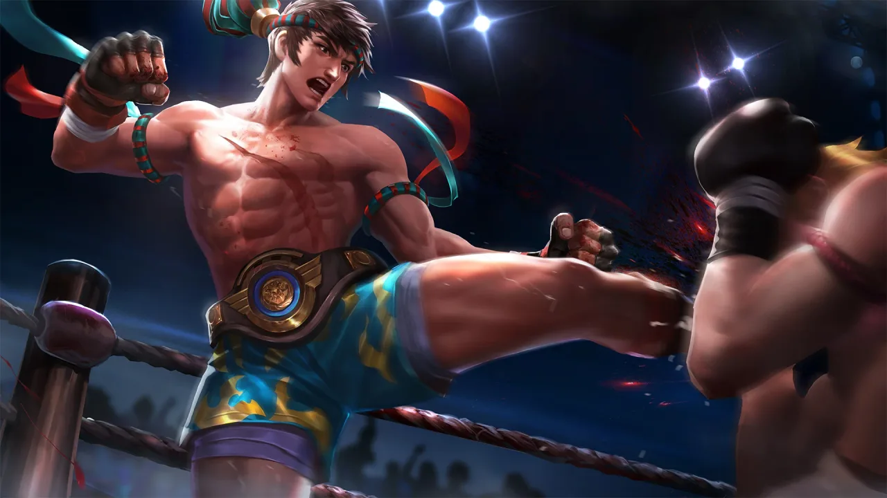

[Chou skins](https://boostmlbb.ru/en/skins/chou.html)

[Skins](https://boostmlbb.ru/en/skins/)/[Chou](https://boostmlbb.ru/en/skins/chou.html)/King of Muay Thai

[Chou skin](https://boostmlbb.ru/en/skins/chou.html)

# King of Muay Thai

CommonEliteIn the shop

How to get

Sold in the skin shop for 599 diamonds.

Price

599 diamonds

Released

2017

## What the skin changes

-   New look
-   Recoloured effects
-   Showcase animation
-   Attribute bonus

## Painted versions

The same skin in other colours. A painted version needs the skin itself.

-   **Undefeated Champion**188 diamonds

## All Chou skins [11](https://boostmlbb.ru/en/skins/chou.html)

[ECHODeluxe · 2023](https://boostmlbb.ru/en/skins/chou/echo.html)[Dragon ShiryuDeluxe · 2022](https://boostmlbb.ru/en/skins/chou/dragon-shiryu.html)[Libra ShiryuGrand · 2022](https://boostmlbb.ru/en/skins/chou/libra-shiryu.html)[S.T.U.N. ChouDeluxe · 2021](https://boostmlbb.ru/en/skins/chou/s-t-u-n-chou.html)[Thun­derfistGrand · 2021](https://boostmlbb.ru/en/skins/chou/thunderfist.html)[Go BallisticExceptional · 2019](https://boostmlbb.ru/en/skins/chou/go-ballistic.html)[Iori YagamiGrand · 2019](https://boostmlbb.ru/en/skins/chou/iori-yagami.html)[Furious TigerExceptional · 2018](https://boostmlbb.ru/en/skins/chou/furious-tiger.html)[King of Muay ThaiCommon · 2017](https://boostmlbb.ru/en/skins/chou/king-of-muay-thai.html)[Dragon BoyExquisite · 2017](https://boostmlbb.ru/en/skins/chou/dragon-boy.html)[Hip-hop BoyCommon · 2016](https://boostmlbb.ru/en/skins/chou/hip-hop-boy.html)

## Elite series

[Golden OsmanthusChang'e · 2026](https://boostmlbb.ru/en/skins/change/golden-osmanthus.html)[Warlord KingMartis · 2025](https://boostmlbb.ru/en/skins/martis/warlord-king.html)[High Seas CadetKimmy · 2024](https://boostmlbb.ru/en/skins/kimmy/high-seas-cadet.html)[Verdant LancerSilvanna · 2024](https://boostmlbb.ru/en/skins/silvanna/verdant-lancer.html)[Bloodhoof MarauderHylos · 2024](https://boostmlbb.ru/en/skins/hylos/bloodhoof-marauder.html)[Elegant ButterflyGuinevere · 2024](https://boostmlbb.ru/en/skins/guinevere/elegant-butterfly.html)[Marques of BladesLancelot · 2024](https://boostmlbb.ru/en/skins/lancelot/marques-of-blades.html)[Badlands HiatusChip · 2024](https://boostmlbb.ru/en/skins/chip/badlands-hiatus.html)

**How much is a rank boost on Chou?**Choose your current and target ranks to see the price here.

[Calculate price](https://boostmlbb.ru/en/order.html?type=hero)

## Frequently asked questions

How to get the King of Muay Thai skin for Chou?

Sold in the skin shop for 599 diamonds.

When was King of Muay Thai released?

2017.

What class is King of Muay Thai?

Common, Elite series.
