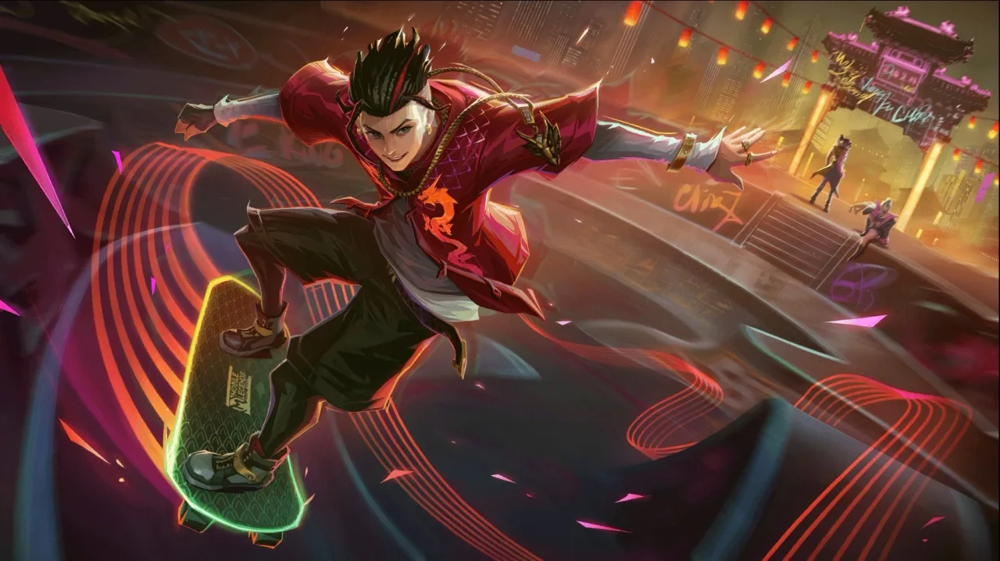
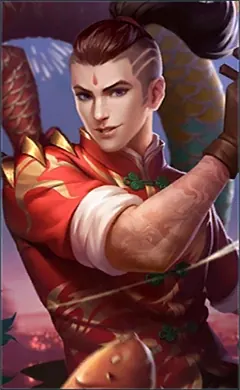

[Tier list](https://boostmlbb.ru/en/heroes/)[Items](https://boostmlbb.ru/en/items/)[Skins](https://boostmlbb.ru/en/skins/)[News & guides](https://boostmlbb.ru/en/news/)

[Skins](https://boostmlbb.ru/en/skins/)/[Chou](https://boostmlbb.ru/en/skins/chou.html)/S.T.U.N. Chou

[Chou skin](https://boostmlbb.ru/en/skins/chou.html)

# S.T.U.N. Chou

DeluxeS.T.U.N.Limited

How to get

Price at release: 899 diamonds. Not sold in the shop now: it comes back only in events.

Price

899 diamonds

Released

April 2021

## What the skin changes

-   New look
-   New skill effects
-   Skill sounds
-   Voice-over
-   Showcase animation
-   Showcase scene
-   Attribute bonus

## All Chou skins [11](https://boostmlbb.ru/en/skins/chou.html)

[ECHODeluxe · 2023](https://boostmlbb.ru/en/skins/chou/echo.html)[Dragon ShiryuDeluxe · 2022](https://boostmlbb.ru/en/skins/chou/dragon-shiryu.html)[Libra ShiryuGrand · 2022](https://boostmlbb.ru/en/skins/chou/libra-shiryu.html)[S.T.U.N. ChouDeluxe · 2021](https://boostmlbb.ru/en/skins/chou/s-t-u-n-chou.html)[Thun­derfistGrand · 2021](https://boostmlbb.ru/en/skins/chou/thunderfist.html)[Go BallisticExceptional · 2019](https://boostmlbb.ru/en/skins/chou/go-ballistic.html)[Iori YagamiGrand · 2019](https://boostmlbb.ru/en/skins/chou/iori-yagami.html)[Furious TigerExceptional · 2018](https://boostmlbb.ru/en/skins/chou/furious-tiger.html)[King of Muay ThaiCommon · 2017](https://boostmlbb.ru/en/skins/chou/king-of-muay-thai.html)[Dragon BoyExquisite · 2017](https://boostmlbb.ru/en/skins/chou/dragon-boy.html)[Hip-hop BoyCommon · 2016](https://boostmlbb.ru/en/skins/chou/hip-hop-boy.html)

## S.T.U.N. series

[S.T.U.N. SelenaSelena · 2021](https://boostmlbb.ru/en/skins/selena/s-t-u-n-selena.html)[S.T.U.N. BrodyBrody · 2021](https://boostmlbb.ru/en/skins/brody/s-t-u-n-brody.html)

**Rank up on Chou**The calculator shows the price

[Calculate price](https://boostmlbb.ru/en/order.html?type=hero)

## Frequently asked questions

How to get the S.T.U.N. Chou skin for Chou?

Price at release: 899 diamonds. Not sold in the shop now: it comes back only in events.

When was S.T.U.N. Chou released?

April 2021.

What class is S.T.U.N. Chou?

Deluxe, S.T.U.N. series.
