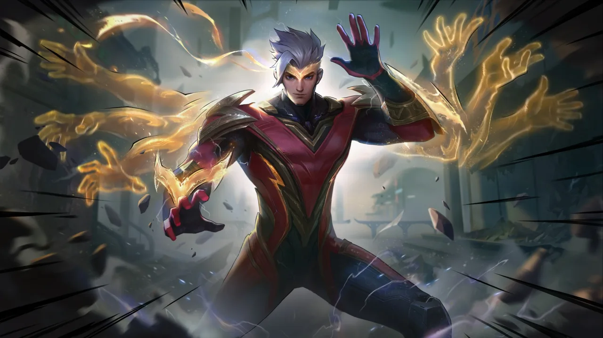
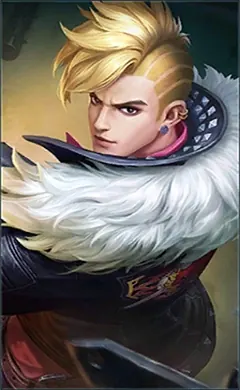
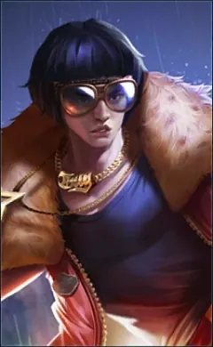

[Chou skins](https://boostmlbb.ru/en/skins/chou.html)

[Skins](https://boostmlbb.ru/en/skins/)/[Chou](https://boostmlbb.ru/en/skins/chou.html)/Thunderfist

[Chou skin](https://boostmlbb.ru/en/skins/chou.html)

# Thunderfist

GrandDawning StarsLimited

How to get

Released in the Dawning Stars event. Limited skins come back in event draws from time to time.

Released

2021

## What the skin changes

-   New look
-   New skill effects
-   Skill sounds
-   Voice-over
-   Showcase animation
-   Showcase scene
-   Attribute bonus

## All Chou skins [11](https://boostmlbb.ru/en/skins/chou.html)

[ECHODeluxe · 2023](https://boostmlbb.ru/en/skins/chou/echo.html)[Dragon ShiryuDeluxe · 2022](https://boostmlbb.ru/en/skins/chou/dragon-shiryu.html)[Libra ShiryuGrand · 2022](https://boostmlbb.ru/en/skins/chou/libra-shiryu.html)[S.T.U.N. ChouDeluxe · 2021](https://boostmlbb.ru/en/skins/chou/s-t-u-n-chou.html)[Thun­derfistGrand · 2021](https://boostmlbb.ru/en/skins/chou/thunderfist.html)[Go BallisticExceptional · 2019](https://boostmlbb.ru/en/skins/chou/go-ballistic.html)[Iori YagamiGrand · 2019](https://boostmlbb.ru/en/skins/chou/iori-yagami.html)[Furious TigerExceptional · 2018](https://boostmlbb.ru/en/skins/chou/furious-tiger.html)[King of Muay ThaiCommon · 2017](https://boostmlbb.ru/en/skins/chou/king-of-muay-thai.html)[Dragon BoyExquisite · 2017](https://boostmlbb.ru/en/skins/chou/dragon-boy.html)[Hip-hop BoyCommon · 2016](https://boostmlbb.ru/en/skins/chou/hip-hop-boy.html)

## Dawning Stars series

[SwordmasterLancelot · 2024](https://boostmlbb.ru/en/skins/lancelot/swordmaster.html)[Blizzard StormVale · 2023](https://boostmlbb.ru/en/skins/vale/blizzard-storm.html)[The ForeseerEsmeralda · 2023](https://boostmlbb.ru/en/skins/esmeralda/the-foreseer.html)[FireboltBruno · 2020](https://boostmlbb.ru/en/skins/bruno/firebolt.html)

**How much is a rank boost on Chou?**Choose your current and target ranks to see the price here.

[Calculate price](https://boostmlbb.ru/en/order.html?type=hero)

## Frequently asked questions

How to get the Thunderfist skin for Chou?

Released in the Dawning Stars event. Limited skins come back in event draws from time to time.

When was Thunderfist released?

2021.

What class is Thunderfist?

Grand, Dawning Stars series.
