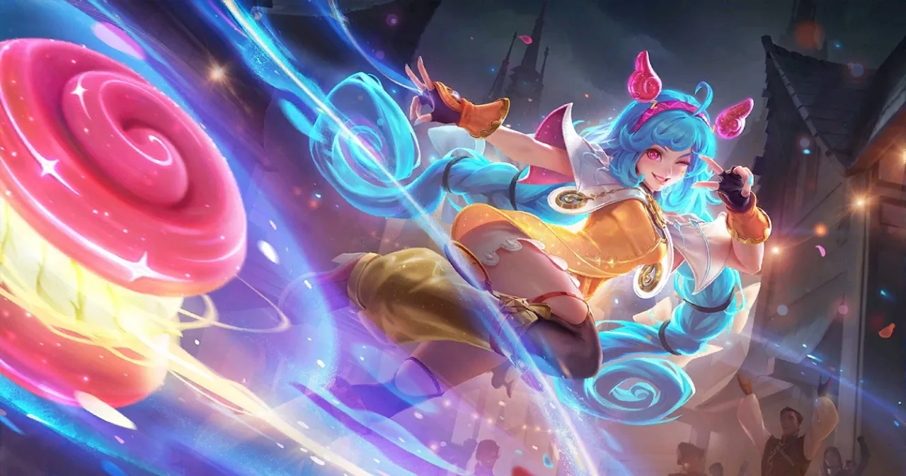

[Tier list](https://boostmlbb.ru/en/heroes/)[Items](https://boostmlbb.ru/en/items/)[Skins](https://boostmlbb.ru/en/skins/)[News & guides](https://boostmlbb.ru/en/news/)

[Skins](https://boostmlbb.ru/en/skins/)/Cici

# Cici skins

Skins

3

In the shop

2

Latest

[P.ACE Cici](https://boostmlbb.ru/en/skins/cici/p-ace-cici.html)2025

[Hero profile→](https://boostmlbb.ru/en/heroes/cici.html)

## All skins

[P.ACE CiciDeluxe · 2025](https://boostmlbb.ru/en/skins/cici/p-ace-cici.html)[Circus ReverieExceptional · 2025](https://boostmlbb.ru/en/skins/cici/circus-reverie.html)[Whimsical CarnivalCommon · 2023](https://boostmlbb.ru/en/skins/cici/whimsical-carnival.html)

**Rank up on Cici**The calculator shows the price

[Calculate price](https://boostmlbb.ru/en/order.html?type=hero)

## Frequently asked questions

How many skins does Cici have?

3 skins, the default look not counted. The newest is P.ACE Cici (16 October 2025).

Which Cici skins can you buy now?

P.ACE Cici (1,089 diamonds), Whimsical Carnival (269 diamonds). The other skins were limited and come back only in events.

What is the rarest Cici skin?

P.ACE Cici, Deluxe class, P.ACE series. Sold in the skin shop for 1,089 diamonds.
