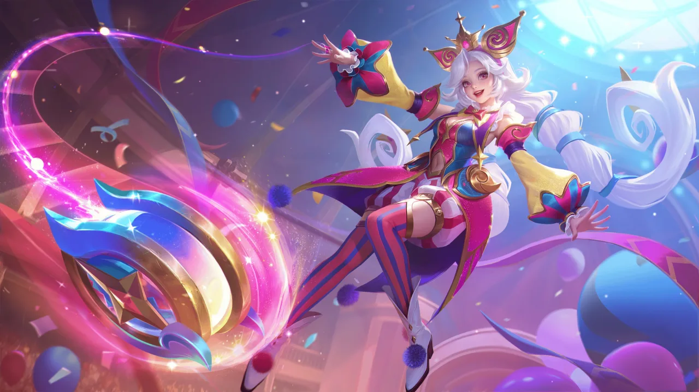

[Cici skins](https://boostmlbb.ru/en/skins/cici.html)

[Skins](https://boostmlbb.ru/en/skins/)/[Cici](https://boostmlbb.ru/en/skins/cici.html)/Circus Reverie

[Cici skin](https://boostmlbb.ru/en/skins/cici.html)

# Circus Reverie

ExceptionalStarLightLimited

How to get

StarLight reward for March 2025.

Released

1 March 2025

## What the skin changes

-   New look
-   New skill effects
-   Showcase animation
-   Showcase scene
-   Attribute bonus

## All Cici skins [3](https://boostmlbb.ru/en/skins/cici.html)

[P.ACE CiciDeluxe · 2025](https://boostmlbb.ru/en/skins/cici/p-ace-cici.html)[Circus ReverieExceptional · 2025](https://boostmlbb.ru/en/skins/cici/circus-reverie.html)[Whimsical CarnivalCommon · 2023](https://boostmlbb.ru/en/skins/cici/whimsical-carnival.html)

## StarLight series

[Tideborn SailorKalea · 2026](https://boostmlbb.ru/en/skins/kalea/tideborn-sailor.html)[Kitsune's ShadowHayabusa · 2026](https://boostmlbb.ru/en/skins/hayabusa/kitsune-s-shadow.html)[Fangs of SlaughterHanzo · 2026](https://boostmlbb.ru/en/skins/hanzo/fangs-of-slaughter.html)[Smoul­dering FortressBelerick · 2026](https://boostmlbb.ru/en/skins/belerick/smouldering-fortress.html)[Magitech WraithObsidia · 2026](https://boostmlbb.ru/en/skins/obsidia/magitech-wraith.html)[Elysian LuminanceZetian · 2026](https://boostmlbb.ru/en/skins/zetian/elysian-luminance.html)[Guardian BattalionHilda · 2026](https://boostmlbb.ru/en/skins/hilda/guardian-battalion.html)[Dreaming KoiHarley · 2026](https://boostmlbb.ru/en/skins/harley/dreaming-koi.html)

**How much is a rank boost on Cici?**Choose your current and target ranks to see the price here.

[Calculate price](https://boostmlbb.ru/en/order.html?type=hero)

## Frequently asked questions

How to get the Circus Reverie skin for Cici?

StarLight reward for March 2025.

When was Circus Reverie released?

1 March 2025.

What class is Circus Reverie?

Exceptional, StarLight series.
