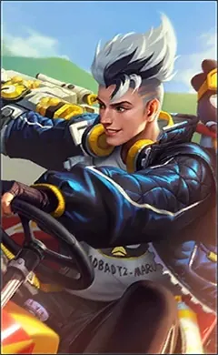

[Tier list](https://boostmlbb.ru/en/heroes/)[Items](https://boostmlbb.ru/en/items/)[Skins](https://boostmlbb.ru/en/skins/)[News & guides](https://boostmlbb.ru/en/news/)

[Skins](https://boostmlbb.ru/en/skins/)/[Claude](https://boostmlbb.ru/en/skins/claude.html)/Bad Bro

[Claude skin](https://boostmlbb.ru/en/skins/claude.html)

# Bad Bro

GrandSanrioLimited

How to get

Released in the MLBB × Sanrio collaboration event. Limited skins come back in event draws from time to time.

Released

5 March 2020

## What the skin changes

-   New look
-   New skill effects
-   Skill sounds
-   Voice-over
-   Showcase animation
-   Showcase scene
-   Attribute bonus

## All Claude skins [11](https://boostmlbb.ru/en/skins/claude.html)

[Mecha DragonExquisite · 2025](https://boostmlbb.ru/en/skins/claude/mecha-dragon.html)[Cosmic BlazeGrand · 2024](https://boostmlbb.ru/en/skins/claude/cosmic-blaze.html)[Challenger's SparkDeluxe · 2024](https://boostmlbb.ru/en/skins/claude/challenger-s-spark.html)[Heart AflameDeluxe · 2024](https://boostmlbb.ru/en/skins/claude/heart-aflame.html)[Blazing TraceDeluxe · 2024](https://boostmlbb.ru/en/skins/claude/blazing-trace.html)[Earth's MightiestExceptional · 2024](https://boostmlbb.ru/en/skins/claude/earth-s-mightiest.html)[Christmas CarnivalExceptional · 2024](https://boostmlbb.ru/en/skins/claude/christmas-carnival.html)[LifeguardExceptional · 2024](https://boostmlbb.ru/en/skins/claude/lifeguard.html)[Golden BulletCommon · 2022](https://boostmlbb.ru/en/skins/claude/golden-bullet.html)[Bad BroGrand · 2020](https://boostmlbb.ru/en/skins/claude/bad-bro.html)[Plunderous PirateExceptional · 2018](https://boostmlbb.ru/en/skins/claude/plunderous-pirate.html)

## Sanrio series

[Fluffy DreamFloryn · 2022](https://boostmlbb.ru/en/skins/floryn/fluffy-dream.html)[Moon ArtistChang'e · 2022](https://boostmlbb.ru/en/skins/change/moon-artist.html)[HeartstringAngela · 2022](https://boostmlbb.ru/en/skins/angela/heartstring.html)

**Rank up on Claude**The calculator shows the price

[Calculate price](https://boostmlbb.ru/en/order.html?type=hero)

## Frequently asked questions

How to get the Bad Bro skin for Claude?

Released in the MLBB × Sanrio collaboration event. Limited skins come back in event draws from time to time.

When was Bad Bro released?

5 March 2020.

What class is Bad Bro?

Grand, Sanrio series.
