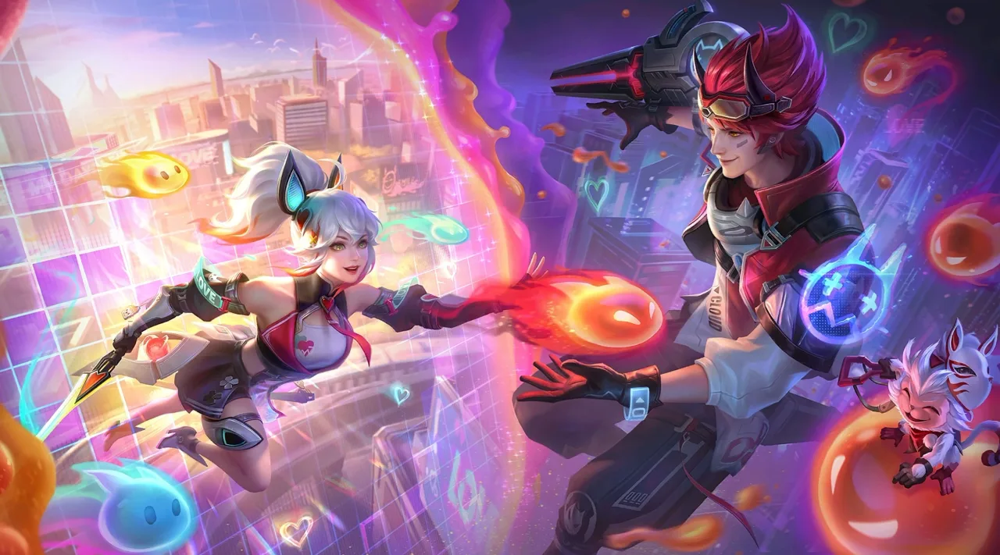

[Tier list](https://boostmlbb.ru/en/heroes/)[Items](https://boostmlbb.ru/en/items/)[Skins](https://boostmlbb.ru/en/skins/)[News & guides](https://boostmlbb.ru/en/news/)

[Skins](https://boostmlbb.ru/en/skins/)/[Claude](https://boostmlbb.ru/en/skins/claude.html)/Heart Aflame

[Claude skin](https://boostmlbb.ru/en/skins/claude.html)

# Heart Aflame

DeluxeValentineLimited

How to get

Released in the skin shop during an event. Limited skins come back in event draws from time to time.

Released

16 March 2024

## What the skin changes

-   New look
-   New skill effects
-   Skill sounds
-   Showcase animation
-   Showcase scene
-   Showcase music
-   Attribute bonus

## All Claude skins [11](https://boostmlbb.ru/en/skins/claude.html)

[Mecha DragonExquisite · 2025](https://boostmlbb.ru/en/skins/claude/mecha-dragon.html)[Cosmic BlazeGrand · 2024](https://boostmlbb.ru/en/skins/claude/cosmic-blaze.html)[Challenger's SparkDeluxe · 2024](https://boostmlbb.ru/en/skins/claude/challenger-s-spark.html)[Heart AflameDeluxe · 2024](https://boostmlbb.ru/en/skins/claude/heart-aflame.html)[Blazing TraceDeluxe · 2024](https://boostmlbb.ru/en/skins/claude/blazing-trace.html)[Earth's MightiestExceptional · 2024](https://boostmlbb.ru/en/skins/claude/earth-s-mightiest.html)[Christmas CarnivalExceptional · 2024](https://boostmlbb.ru/en/skins/claude/christmas-carnival.html)[LifeguardExceptional · 2024](https://boostmlbb.ru/en/skins/claude/lifeguard.html)[Golden BulletCommon · 2022](https://boostmlbb.ru/en/skins/claude/golden-bullet.html)[Bad BroGrand · 2020](https://boostmlbb.ru/en/skins/claude/bad-bro.html)[Plunderous PirateExceptional · 2018](https://boostmlbb.ru/en/skins/claude/plunderous-pirate.html)

## Valentine series

[Alluring EnigmaGranger · 2024](https://boostmlbb.ru/en/skins/granger/alluring-enigma.html)[Alluring MystiqueSilvanna · 2024](https://boostmlbb.ru/en/skins/silvanna/alluring-mystique.html)[Gentleman ThiefKhufra · 2023](https://boostmlbb.ru/en/skins/khufra/gentleman-thief.html)[Heart AfloatFanny · 2022](https://boostmlbb.ru/en/skins/fanny/heart-afloat.html)[Phantom CountessCarmilla · 2021](https://boostmlbb.ru/en/skins/carmilla/phantom-countess.html)[Phantom CountCecilion · 2021](https://boostmlbb.ru/en/skins/cecilion/phantom-count.html)[Lady ThiefEsmeralda · 2020](https://boostmlbb.ru/en/skins/esmeralda/lady-thief.html)[Dangerous LoveLesley · 2019](https://boostmlbb.ru/en/skins/lesley/dangerous-love.html)

**Rank up on Claude**The calculator shows the price

[Calculate price](https://boostmlbb.ru/en/order.html?type=hero)

## Frequently asked questions

How to get the Heart Aflame skin for Claude?

Released in the skin shop during an event. Limited skins come back in event draws from time to time.

When was Heart Aflame released?

16 March 2024.

What class is Heart Aflame?

Deluxe, Valentine series.
