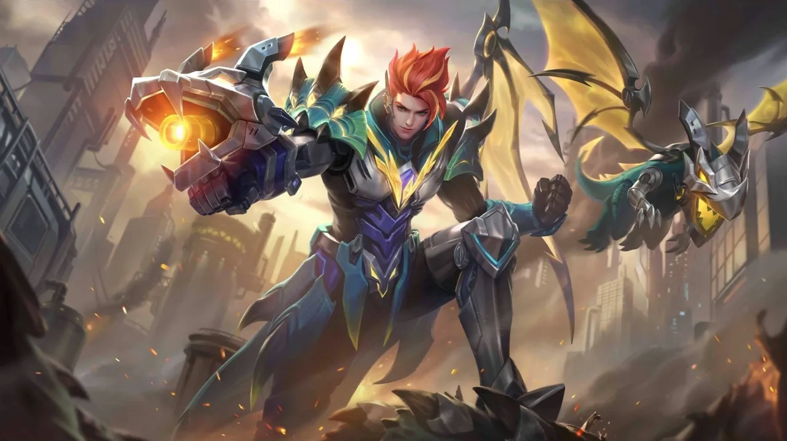

[Tier list](https://boostmlbb.ru/en/heroes/)[Items](https://boostmlbb.ru/en/items/)[Skins](https://boostmlbb.ru/en/skins/)[News & guides](https://boostmlbb.ru/en/news/)

[Skins](https://boostmlbb.ru/en/skins/)/[Claude](https://boostmlbb.ru/en/skins/claude.html)/Mecha Dragon

[Claude skin](https://boostmlbb.ru/en/skins/claude.html)

# Mecha Dragon

ExquisiteLuckyboxLimited

How to get

Came out of Lucky Boxes in events. Limited skins come back in event draws from time to time.

Released

3 April 2025

## What the skin changes

-   New look
-   New skill effects
-   Skill sounds
-   Voice-over
-   Showcase animation
-   Showcase scene
-   Showcase music
-   Special actions
-   Attribute bonus

## All Claude skins [11](https://boostmlbb.ru/en/skins/claude.html)

[Mecha DragonExquisite · 2025](https://boostmlbb.ru/en/skins/claude/mecha-dragon.html)[Cosmic BlazeGrand · 2024](https://boostmlbb.ru/en/skins/claude/cosmic-blaze.html)[Challenger's SparkDeluxe · 2024](https://boostmlbb.ru/en/skins/claude/challenger-s-spark.html)[Heart AflameDeluxe · 2024](https://boostmlbb.ru/en/skins/claude/heart-aflame.html)[Blazing TraceDeluxe · 2024](https://boostmlbb.ru/en/skins/claude/blazing-trace.html)[Earth's MightiestExceptional · 2024](https://boostmlbb.ru/en/skins/claude/earth-s-mightiest.html)[Christmas CarnivalExceptional · 2024](https://boostmlbb.ru/en/skins/claude/christmas-carnival.html)[LifeguardExceptional · 2024](https://boostmlbb.ru/en/skins/claude/lifeguard.html)[Golden BulletCommon · 2022](https://boostmlbb.ru/en/skins/claude/golden-bullet.html)[Bad BroGrand · 2020](https://boostmlbb.ru/en/skins/claude/bad-bro.html)[Plunderous PirateExceptional · 2018](https://boostmlbb.ru/en/skins/claude/plunderous-pirate.html)

## Luckybox series

[Lady CraneGuinevere · 2025](https://boostmlbb.ru/en/skins/guinevere/lady-crane.html)[Butterfly SeraphimLunox · 2025](https://boostmlbb.ru/en/skins/lunox/butterfly-seraphim.html)[Lunar MagicChang'e · 2020](https://boostmlbb.ru/en/skins/change/lunar-magic.html)[Thunder FlashSelena · 2020](https://boostmlbb.ru/en/skins/selena/thunder-flash.html)[RaksheshaHanabi · 2020](https://boostmlbb.ru/en/skins/hanabi/rakshesha.html)[Video-Game DominatorUranus · 2020](https://boostmlbb.ru/en/skins/uranus/video-game-dominator.html)[God of WarMartis · 2020](https://boostmlbb.ru/en/skins/martis/god-of-war.html)[Valhalla RulerFranco · 2020](https://boostmlbb.ru/en/skins/franco/valhalla-ruler.html)

**Rank up on Claude**The calculator shows the price

[Calculate price](https://boostmlbb.ru/en/order.html?type=hero)

## Frequently asked questions

How to get the Mecha Dragon skin for Claude?

Came out of Lucky Boxes in events. Limited skins come back in event draws from time to time.

When was Mecha Dragon released?

3 April 2025.

What class is Mecha Dragon?

Exquisite, Luckybox series.
