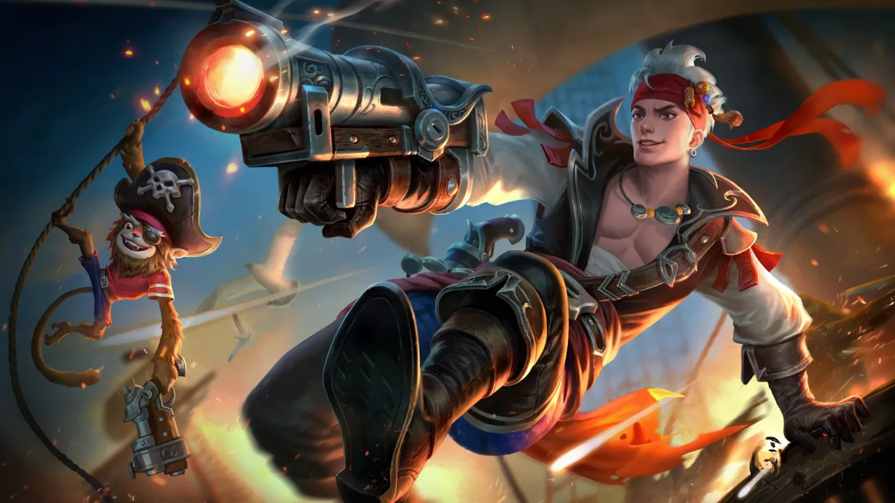

[Claude skins](https://boostmlbb.ru/en/skins/claude.html)

[Skins](https://boostmlbb.ru/en/skins/)/[Claude](https://boostmlbb.ru/en/skins/claude.html)/Plunderous Pirate

[Claude skin](https://boostmlbb.ru/en/skins/claude.html)

# Plunderous Pirate

ExceptionalStarLightLimited

How to get

StarLight reward for November 2018.

Released

1 November 2018

## What the skin changes

-   New look
-   New skill effects
-   Showcase animation
-   Attribute bonus

## All Claude skins [11](https://boostmlbb.ru/en/skins/claude.html)

[Mecha DragonExquisite · 2025](https://boostmlbb.ru/en/skins/claude/mecha-dragon.html)[Cosmic BlazeGrand · 2024](https://boostmlbb.ru/en/skins/claude/cosmic-blaze.html)[Challenger's SparkDeluxe · 2024](https://boostmlbb.ru/en/skins/claude/challenger-s-spark.html)[Heart AflameDeluxe · 2024](https://boostmlbb.ru/en/skins/claude/heart-aflame.html)[Blazing TraceDeluxe · 2024](https://boostmlbb.ru/en/skins/claude/blazing-trace.html)[Earth's MightiestExceptional · 2024](https://boostmlbb.ru/en/skins/claude/earth-s-mightiest.html)[Christmas CarnivalExceptional · 2024](https://boostmlbb.ru/en/skins/claude/christmas-carnival.html)[LifeguardExceptional · 2024](https://boostmlbb.ru/en/skins/claude/lifeguard.html)[Golden BulletCommon · 2022](https://boostmlbb.ru/en/skins/claude/golden-bullet.html)[Bad BroGrand · 2020](https://boostmlbb.ru/en/skins/claude/bad-bro.html)[Plunderous PirateExceptional · 2018](https://boostmlbb.ru/en/skins/claude/plunderous-pirate.html)

## StarLight series

[Tideborn SailorKalea · 2026](https://boostmlbb.ru/en/skins/kalea/tideborn-sailor.html)[Kitsune's ShadowHayabusa · 2026](https://boostmlbb.ru/en/skins/hayabusa/kitsune-s-shadow.html)[Fangs of SlaughterHanzo · 2026](https://boostmlbb.ru/en/skins/hanzo/fangs-of-slaughter.html)[Smoul­dering FortressBelerick · 2026](https://boostmlbb.ru/en/skins/belerick/smouldering-fortress.html)[Magitech WraithObsidia · 2026](https://boostmlbb.ru/en/skins/obsidia/magitech-wraith.html)[Elysian LuminanceZetian · 2026](https://boostmlbb.ru/en/skins/zetian/elysian-luminance.html)[Guardian BattalionHilda · 2026](https://boostmlbb.ru/en/skins/hilda/guardian-battalion.html)[Dreaming KoiHarley · 2026](https://boostmlbb.ru/en/skins/harley/dreaming-koi.html)

**How much is a rank boost on Claude?**Choose your current and target ranks to see the price here.

[Calculate price](https://boostmlbb.ru/en/order.html?type=hero)

## Frequently asked questions

How to get the Plunderous Pirate skin for Claude?

StarLight reward for November 2018.

When was Plunderous Pirate released?

1 November 2018.

What class is Plunderous Pirate?

Exceptional, StarLight series.
