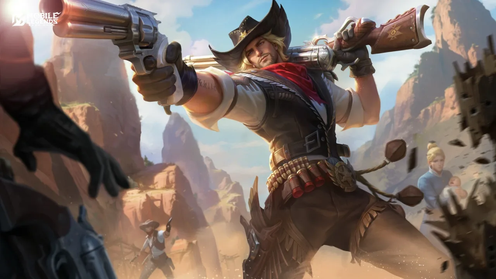
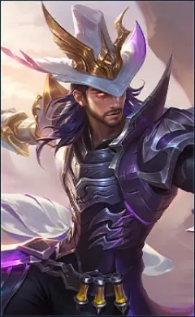

[Tier list](https://boostmlbb.ru/en/heroes/)[Items](https://boostmlbb.ru/en/items/)[Skins](https://boostmlbb.ru/en/skins/)[News & guides](https://boostmlbb.ru/en/news/)

[Skins](https://boostmlbb.ru/en/skins/)/Clint

# Clint skins

Skins

12

In the shop

4

Latest

[Scarlet Musketeer](https://boostmlbb.ru/en/skins/clint/scarlet-musketeer.html)2026

[Hero profile→](https://boostmlbb.ru/en/heroes/clint.html)

## All skins

AllExquisiteDeluxeExceptionalCommon

[Scarlet MusketeerCommon · 2026](https://boostmlbb.ru/en/skins/clint/scarlet-musketeer.html)[Dragon's MawDeluxe · 2024](https://boostmlbb.ru/en/skins/clint/dragon-s-maw.html)[Captain of the ReefsDeluxe · 2024](https://boostmlbb.ru/en/skins/clint/captain-of-the-reefs.html)[Crimson BlastExquisite · 2023](https://boostmlbb.ru/en/skins/clint/crimson-blast.html)[Operator CLExceptional · 2022](https://boostmlbb.ru/en/skins/clint/operator-cl.html)[Shadow OmenDeluxe · 2020](https://boostmlbb.ru/en/skins/clint/shadow-omen.html)[Witch HunterCommon · 2020](https://boostmlbb.ru/en/skins/clint/witch-hunter.html)[Badminton ChampionExceptional · 2019](https://boostmlbb.ru/en/skins/clint/badminton-champion.html)[Rock and RollExceptional · 2017](https://boostmlbb.ru/en/skins/clint/rock-and-roll.html)[Guns and RosesExceptional · 2017](https://boostmlbb.ru/en/skins/clint/guns-and-roses.html)[Sun n SandExceptional · 2016](https://boostmlbb.ru/en/skins/clint/sun-n-sand.html)[Vessel of Ruin](https://boostmlbb.ru/en/skins/clint/vessel-of-ruin.html)

**Rank up on Clint**The calculator shows the price

[Calculate price](https://boostmlbb.ru/en/order.html?type=hero)

## Frequently asked questions

How many skins does Clint have?

12 skins, the default look not counted. The newest is Scarlet Musketeer (16 September 2026).

Which Clint skins can you buy now?

Scarlet Musketeer (269 diamonds), Captain of the Reefs (899 diamonds), Badminton Champion (749 diamonds), Sun n Sand (399 diamonds). The other skins were limited and come back only in events.

What is the rarest Clint skin?

Crimson Blast, Exquisite class, Collector series. The top prize of a Collector event draw, paid with diamonds. Limited skins come back in event draws from time to time.
