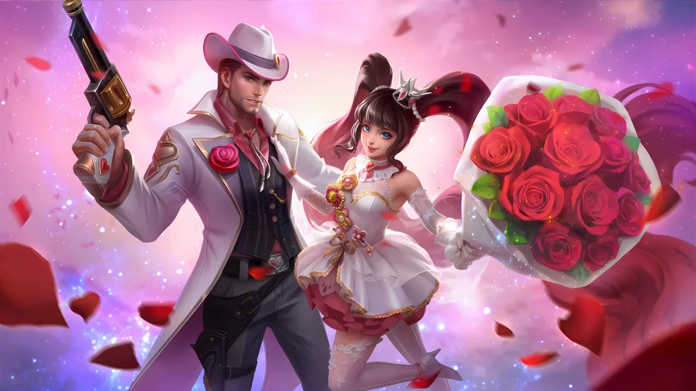
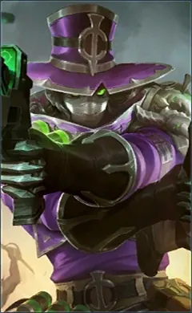
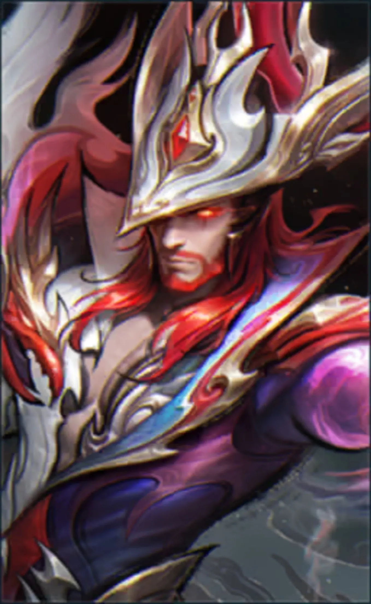

[Clint skins](https://boostmlbb.ru/en/skins/clint.html)

[Skins](https://boostmlbb.ru/en/skins/)/[Clint](https://boostmlbb.ru/en/skins/clint.html)/Guns and Roses

[Clint skin](https://boostmlbb.ru/en/skins/clint.html)

# Guns and Roses

ExceptionalValentineLimited

How to get

Released in the skin shop during an event. Limited skins come back in event draws from time to time.

Released

2017

## What the skin changes

-   New look
-   New skill effects
-   Showcase animation
-   Showcase scene
-   Attribute bonus

## All Clint skins [12](https://boostmlbb.ru/en/skins/clint.html)

[Scarlet MusketeerCommon · 2026](https://boostmlbb.ru/en/skins/clint/scarlet-musketeer.html)[Dragon's MawDeluxe · 2024](https://boostmlbb.ru/en/skins/clint/dragon-s-maw.html)[Captain of the ReefsDeluxe · 2024](https://boostmlbb.ru/en/skins/clint/captain-of-the-reefs.html)[Crimson BlastExquisite · 2023](https://boostmlbb.ru/en/skins/clint/crimson-blast.html)[Operator CLExceptional · 2022](https://boostmlbb.ru/en/skins/clint/operator-cl.html)[Shadow OmenDeluxe · 2020](https://boostmlbb.ru/en/skins/clint/shadow-omen.html)[Witch HunterCommon · 2020](https://boostmlbb.ru/en/skins/clint/witch-hunter.html)[Badminton ChampionExceptional · 2019](https://boostmlbb.ru/en/skins/clint/badminton-champion.html)[Rock and RollExceptional · 2017](https://boostmlbb.ru/en/skins/clint/rock-and-roll.html)[Guns and RosesExceptional · 2017](https://boostmlbb.ru/en/skins/clint/guns-and-roses.html)[Sun n SandExceptional · 2016](https://boostmlbb.ru/en/skins/clint/sun-n-sand.html)[Vessel of Ruin](https://boostmlbb.ru/en/skins/clint/vessel-of-ruin.html)

## Valentine series

[Heart AflameClaude · 2024](https://boostmlbb.ru/en/skins/claude/heart-aflame.html)[Alluring EnigmaGranger · 2024](https://boostmlbb.ru/en/skins/granger/alluring-enigma.html)[Alluring MystiqueSilvanna · 2024](https://boostmlbb.ru/en/skins/silvanna/alluring-mystique.html)[Gentleman ThiefKhufra · 2023](https://boostmlbb.ru/en/skins/khufra/gentleman-thief.html)[Heart AfloatFanny · 2022](https://boostmlbb.ru/en/skins/fanny/heart-afloat.html)[Phantom CountessCarmilla · 2021](https://boostmlbb.ru/en/skins/carmilla/phantom-countess.html)[Phantom CountCecilion · 2021](https://boostmlbb.ru/en/skins/cecilion/phantom-count.html)[Lady ThiefEsmeralda · 2020](https://boostmlbb.ru/en/skins/esmeralda/lady-thief.html)

**How much is a rank boost on Clint?**Choose your current and target ranks to see the price here.

[Calculate price](https://boostmlbb.ru/en/order.html?type=hero)

## Frequently asked questions

How to get the Guns and Roses skin for Clint?

Released in the skin shop during an event. Limited skins come back in event draws from time to time.

When was Guns and Roses released?

2017.

What class is Guns and Roses?

Exceptional, Valentine series.
