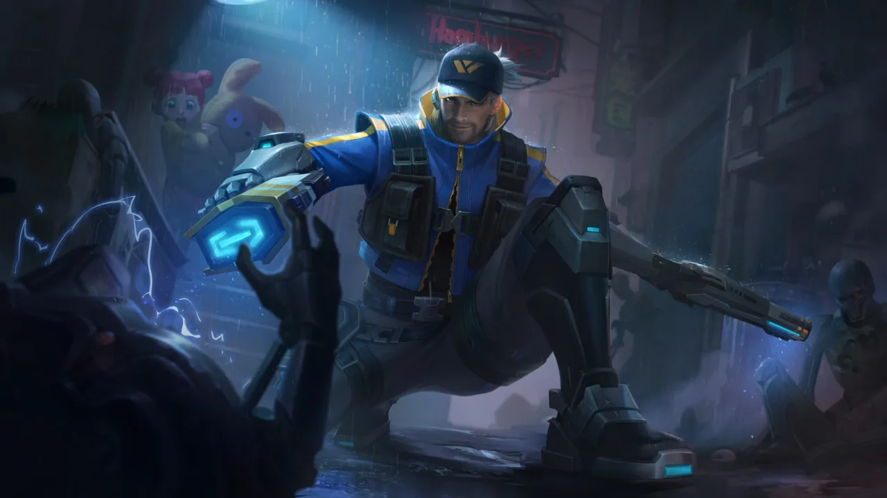

[Clint skins](https://boostmlbb.ru/en/skins/clint.html)

[Skins](https://boostmlbb.ru/en/skins/)/[Clint](https://boostmlbb.ru/en/skins/clint.html)/Operator CL

[Clint skin](https://boostmlbb.ru/en/skins/clint.html)

# Operator CL

ExceptionalStarLightLimited

How to get

StarLight reward for January 2022.

Released

1 January 2022

## What the skin changes

-   New look
-   New skill effects
-   Showcase animation
-   Showcase scene
-   Attribute bonus

## All Clint skins [12](https://boostmlbb.ru/en/skins/clint.html)

[Scarlet MusketeerCommon · 2026](https://boostmlbb.ru/en/skins/clint/scarlet-musketeer.html)[Dragon's MawDeluxe · 2024](https://boostmlbb.ru/en/skins/clint/dragon-s-maw.html)[Captain of the ReefsDeluxe · 2024](https://boostmlbb.ru/en/skins/clint/captain-of-the-reefs.html)[Crimson BlastExquisite · 2023](https://boostmlbb.ru/en/skins/clint/crimson-blast.html)[Operator CLExceptional · 2022](https://boostmlbb.ru/en/skins/clint/operator-cl.html)[Shadow OmenDeluxe · 2020](https://boostmlbb.ru/en/skins/clint/shadow-omen.html)[Witch HunterCommon · 2020](https://boostmlbb.ru/en/skins/clint/witch-hunter.html)[Badminton ChampionExceptional · 2019](https://boostmlbb.ru/en/skins/clint/badminton-champion.html)[Rock and RollExceptional · 2017](https://boostmlbb.ru/en/skins/clint/rock-and-roll.html)[Guns and RosesExceptional · 2017](https://boostmlbb.ru/en/skins/clint/guns-and-roses.html)[Sun n SandExceptional · 2016](https://boostmlbb.ru/en/skins/clint/sun-n-sand.html)[Vessel of Ruin](https://boostmlbb.ru/en/skins/clint/vessel-of-ruin.html)

## StarLight series

[Tideborn SailorKalea · 2026](https://boostmlbb.ru/en/skins/kalea/tideborn-sailor.html)[Kitsune's ShadowHayabusa · 2026](https://boostmlbb.ru/en/skins/hayabusa/kitsune-s-shadow.html)[Fangs of SlaughterHanzo · 2026](https://boostmlbb.ru/en/skins/hanzo/fangs-of-slaughter.html)[Smoul­dering FortressBelerick · 2026](https://boostmlbb.ru/en/skins/belerick/smouldering-fortress.html)[Magitech WraithObsidia · 2026](https://boostmlbb.ru/en/skins/obsidia/magitech-wraith.html)[Elysian LuminanceZetian · 2026](https://boostmlbb.ru/en/skins/zetian/elysian-luminance.html)[Guardian BattalionHilda · 2026](https://boostmlbb.ru/en/skins/hilda/guardian-battalion.html)[Dreaming KoiHarley · 2026](https://boostmlbb.ru/en/skins/harley/dreaming-koi.html)

**How much is a rank boost on Clint?**Choose your current and target ranks to see the price here.

[Calculate price](https://boostmlbb.ru/en/order.html?type=hero)

## Frequently asked questions

How to get the Operator CL skin for Clint?

StarLight reward for January 2022.

When was Operator CL released?

1 January 2022.

What class is Operator CL?

Exceptional, StarLight series.
