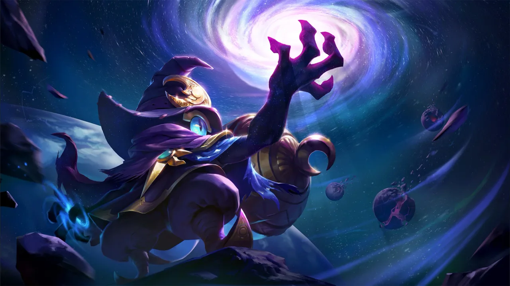

[Tier list](https://boostmlbb.ru/en/heroes/)[Items](https://boostmlbb.ru/en/items/)[Skins](https://boostmlbb.ru/en/skins/)[News & guides](https://boostmlbb.ru/en/news/)

[Skins](https://boostmlbb.ru/en/skins/)/Cyclops

# Cyclops skins

Skins

9

In the shop

4

Latest

[SpongeBob](https://boostmlbb.ru/en/skins/cyclops/spongebob.html)2025

[Hero profile→](https://boostmlbb.ru/en/heroes/cyclops.html)

## All skins

AllGrandExquisiteDeluxeExceptionalCommon

[SpongeBobDeluxe · 2025](https://boostmlbb.ru/en/skins/cyclops/spongebob.html)[Yokai WarlockExquisite · 2023](https://boostmlbb.ru/en/skins/cyclops/yokai-warlock.html)[Straw DollExceptional · 2021](https://boostmlbb.ru/en/skins/cyclops/straw-doll.html)[Master YodaGrand · 2021](https://boostmlbb.ru/en/skins/cyclops/master-yoda.html)[Deep Sea RescuerExceptional · 2018](https://boostmlbb.ru/en/skins/cyclops/deep-sea-rescuer.html)[Zombie BambinoCommon · 2018](https://boostmlbb.ru/en/skins/cyclops/zombie-bambino.html)[S.A.B.E.R. EnforcerDeluxe · 2018](https://boostmlbb.ru/en/skins/cyclops/s-a-b-e-r-enforcer.html)[Super AdventurerCommon · 2017](https://boostmlbb.ru/en/skins/cyclops/super-adventurer.html)[ExorcistCommon · 2017](https://boostmlbb.ru/en/skins/cyclops/exorcist.html)

**Rank up on Cyclops**The calculator shows the price

[Calculate price](https://boostmlbb.ru/en/order.html?type=hero)

## Frequently asked questions

How many skins does Cyclops have?

9 skins, the default look not counted. The newest is SpongeBob (19 December 2025).

Which Cyclops skins can you buy now?

Straw Doll (749 diamonds), S.A.B.E.R. Enforcer (899 diamonds), Super Adventurer (599 diamonds), Exorcist (269 diamonds). The other skins were limited and come back only in events.

What is the rarest Cyclops skin?

Master Yoda, Grand class, Star Wars series. Released in the MLBB × Star Wars collaboration event. Limited skins come back in event draws from time to time.
