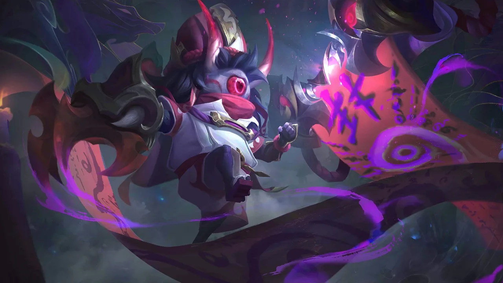

[Tier list](https://boostmlbb.ru/en/heroes/)[Items](https://boostmlbb.ru/en/items/)[Skins](https://boostmlbb.ru/en/skins/)[News & guides](https://boostmlbb.ru/en/news/)

[Skins](https://boostmlbb.ru/en/skins/)/[Cyclops](https://boostmlbb.ru/en/skins/cyclops.html)/Yokai Warlock

[Cyclops skin](https://boostmlbb.ru/en/skins/cyclops.html)

# Yokai Warlock

ExquisiteCollectorLimited

How to get

The top prize of a Collector event draw, paid with diamonds. Limited skins come back in event draws from time to time.

Released

10 April 2023

## What the skin changes

-   New look
-   New skill effects
-   Skill sounds
-   Voice-over
-   Showcase animation
-   Showcase scene
-   Showcase music
-   Special actions
-   Attribute bonus

## All Cyclops skins [9](https://boostmlbb.ru/en/skins/cyclops.html)

[SpongeBobDeluxe · 2025](https://boostmlbb.ru/en/skins/cyclops/spongebob.html)[Yokai WarlockExquisite · 2023](https://boostmlbb.ru/en/skins/cyclops/yokai-warlock.html)[Straw DollExceptional · 2021](https://boostmlbb.ru/en/skins/cyclops/straw-doll.html)[Master YodaGrand · 2021](https://boostmlbb.ru/en/skins/cyclops/master-yoda.html)[Deep Sea RescuerExceptional · 2018](https://boostmlbb.ru/en/skins/cyclops/deep-sea-rescuer.html)[Zombie BambinoCommon · 2018](https://boostmlbb.ru/en/skins/cyclops/zombie-bambino.html)[S.A.B.E.R. EnforcerDeluxe · 2018](https://boostmlbb.ru/en/skins/cyclops/s-a-b-e-r-enforcer.html)[Super AdventurerCommon · 2017](https://boostmlbb.ru/en/skins/cyclops/super-adventurer.html)[ExorcistCommon · 2017](https://boostmlbb.ru/en/skins/cyclops/exorcist.html)

## Collector series

[The PurifierBruno · 2026](https://boostmlbb.ru/en/skins/bruno/the-purifier.html)[Celestial RebelSun · 2026](https://boostmlbb.ru/en/skins/sun/celestial-rebel.html)[Kaiju of the DeepHelcurt · 2026](https://boostmlbb.ru/en/skins/helcurt/kaiju-of-the-deep.html)[Starbound SentryKimmy · 2026](https://boostmlbb.ru/en/skins/kimmy/starbound-sentry.html)[Dreaming MonarchAlice · 2026](https://boostmlbb.ru/en/skins/alice/dreaming-monarch.html)[Tremor of the DeepGrock · 2026](https://boostmlbb.ru/en/skins/grock/tremor-of-the-deep.html)[Celestial GeneralTigreal · 2026](https://boostmlbb.ru/en/skins/tigreal/celestial-general.html)[Sunborn MonarchXavier · 2026](https://boostmlbb.ru/en/skins/xavier/sunborn-monarch.html)

**Rank up on Cyclops**The calculator shows the price

[Calculate price](https://boostmlbb.ru/en/order.html?type=hero)

## Frequently asked questions

How to get the Yokai Warlock skin for Cyclops?

The top prize of a Collector event draw, paid with diamonds. Limited skins come back in event draws from time to time.

When was Yokai Warlock released?

10 April 2023.

What class is Yokai Warlock?

Exquisite, Collector series.
