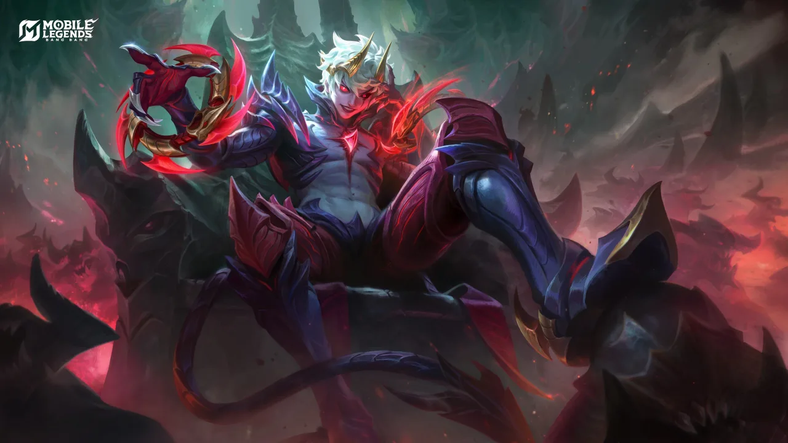

[All skins](https://boostmlbb.ru/en/skins/)

[Skins](https://boostmlbb.ru/en/skins/)/Dyrroth

# Dyrroth skins

Skins

6

In the shop

2

Latest

[Gon](https://boostmlbb.ru/en/skins/dyrroth/gon.html)2025

[Hero profile→](https://boostmlbb.ru/en/heroes/dyrroth.html)

## All skins

[GonGrand · 2025](https://boostmlbb.ru/en/skins/dyrroth/gon.html)[Naraka FlameExquisite · 2023](https://boostmlbb.ru/en/skins/dyrroth/naraka-flame.html)[V.E.N.O.M. CobraDeluxe · 2022](https://boostmlbb.ru/en/skins/dyrroth/v-e-n-o-m-cobra.html)[Orochi ChrisGrand · 2020](https://boostmlbb.ru/en/skins/dyrroth/orochi-chris.html)[Ruins ScavengerExceptional · 2019](https://boostmlbb.ru/en/skins/dyrroth/ruins-scavenger.html)[ScaleboreCommon · 2019](https://boostmlbb.ru/en/skins/dyrroth/scalebore.html)

**How much is a rank boost on Dyrroth?**Choose your current and target ranks to see the price here.

[Calculate price](https://boostmlbb.ru/en/order.html?type=hero)

## Frequently asked questions

How many skins does Dyrroth have?

6 skins, the default look not counted. The newest is Gon (14 January 2025).

Which Dyrroth skins can you buy now?

V.E.N.O.M. Cobra (899 diamonds), Scalebore (269 diamonds). The other skins were limited and come back only in events.

What is the rarest Dyrroth skin?

Gon, Grand class, HUNTER×HUNTER series. Released in the MLBB × HUNTER×HUNTER collaboration event. Limited skins come back in event draws from time to time.
