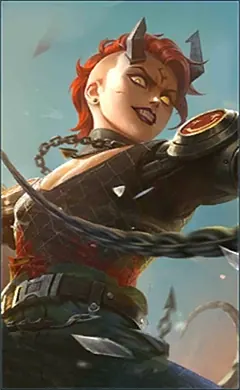

[Dyrroth skins](https://boostmlbb.ru/en/skins/dyrroth.html)

[Skins](https://boostmlbb.ru/en/skins/)/[Dyrroth](https://boostmlbb.ru/en/skins/dyrroth.html)/Gon

[Dyrroth skin](https://boostmlbb.ru/en/skins/dyrroth.html)

# Gon

GrandHUNTER×HUNTERLimited

How to get

Released in the MLBB × HUNTER×HUNTER collaboration event. Limited skins come back in event draws from time to time.

Released

14 January 2025

## What the skin changes

-   New look
-   New skill effects
-   Skill sounds
-   Voice-over
-   Skill icons
-   Showcase animation
-   Showcase scene
-   Showcase music
-   Spawn animation
-   Special actions
-   Attribute bonus

## All Dyrroth skins [6](https://boostmlbb.ru/en/skins/dyrroth.html)

[GonGrand · 2025](https://boostmlbb.ru/en/skins/dyrroth/gon.html)[Naraka FlameExquisite · 2023](https://boostmlbb.ru/en/skins/dyrroth/naraka-flame.html)[V.E.N.O.M. CobraDeluxe · 2022](https://boostmlbb.ru/en/skins/dyrroth/v-e-n-o-m-cobra.html)[Orochi ChrisGrand · 2020](https://boostmlbb.ru/en/skins/dyrroth/orochi-chris.html)[Ruins ScavengerExceptional · 2019](https://boostmlbb.ru/en/skins/dyrroth/ruins-scavenger.html)[ScaleboreCommon · 2019](https://boostmlbb.ru/en/skins/dyrroth/scalebore.html)

## HUNTER×HUNTER series

[HisokaCecilion · 2025](https://boostmlbb.ru/en/skins/cecilion/hisoka.html)[KilluaHarith · 2025](https://boostmlbb.ru/en/skins/harith/killua.html)[KurapikaJulian · 2025](https://boostmlbb.ru/en/skins/julian/kurapika.html)

**How much is a rank boost on Dyrroth?**Choose your current and target ranks to see the price here.

[Calculate price](https://boostmlbb.ru/en/order.html?type=hero)

## Frequently asked questions

How to get the Gon skin for Dyrroth?

Released in the MLBB × HUNTER×HUNTER collaboration event. Limited skins come back in event draws from time to time.

When was Gon released?

14 January 2025.

What class is Gon?

Grand, HUNTER×HUNTER series.
