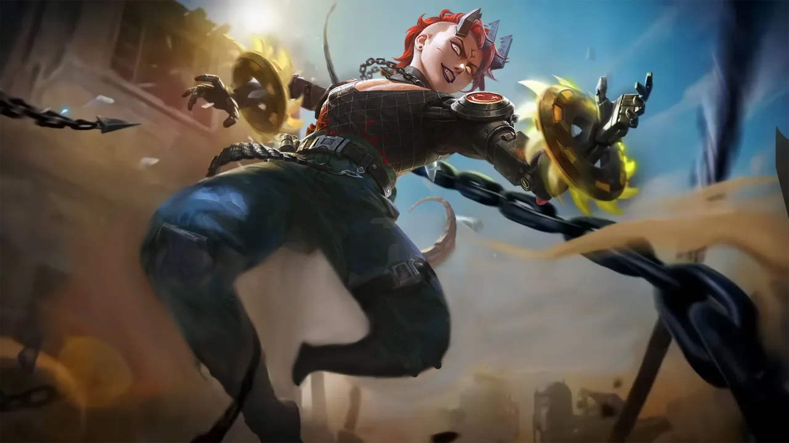
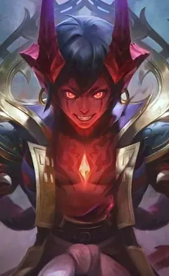

[Tier list](https://boostmlbb.ru/en/heroes/)[Items](https://boostmlbb.ru/en/items/)[Skins](https://boostmlbb.ru/en/skins/)[News & guides](https://boostmlbb.ru/en/news/)

[Skins](https://boostmlbb.ru/en/skins/)/[Dyrroth](https://boostmlbb.ru/en/skins/dyrroth.html)/Ruins Scavenger

[Dyrroth skin](https://boostmlbb.ru/en/skins/dyrroth.html)

# Ruins Scavenger

ExceptionalStarLightLimited

How to get

StarLight reward for December 2019.

Released

1 December 2019

## What the skin changes

-   New look
-   New skill effects
-   Showcase animation
-   Attribute bonus

## All Dyrroth skins [6](https://boostmlbb.ru/en/skins/dyrroth.html)

[GonGrand · 2025](https://boostmlbb.ru/en/skins/dyrroth/gon.html)[Naraka FlameExquisite · 2023](https://boostmlbb.ru/en/skins/dyrroth/naraka-flame.html)[V.E.N.O.M. CobraDeluxe · 2022](https://boostmlbb.ru/en/skins/dyrroth/v-e-n-o-m-cobra.html)[Orochi ChrisGrand · 2020](https://boostmlbb.ru/en/skins/dyrroth/orochi-chris.html)[Ruins ScavengerExceptional · 2019](https://boostmlbb.ru/en/skins/dyrroth/ruins-scavenger.html)[ScaleboreCommon · 2019](https://boostmlbb.ru/en/skins/dyrroth/scalebore.html)

## StarLight series

[Tideborn SailorKalea · 2026](https://boostmlbb.ru/en/skins/kalea/tideborn-sailor.html)[Kitsune's ShadowHayabusa · 2026](https://boostmlbb.ru/en/skins/hayabusa/kitsune-s-shadow.html)[Fangs of SlaughterHanzo · 2026](https://boostmlbb.ru/en/skins/hanzo/fangs-of-slaughter.html)[Smoul­dering FortressBelerick · 2026](https://boostmlbb.ru/en/skins/belerick/smouldering-fortress.html)[Magitech WraithObsidia · 2026](https://boostmlbb.ru/en/skins/obsidia/magitech-wraith.html)[Elysian LuminanceZetian · 2026](https://boostmlbb.ru/en/skins/zetian/elysian-luminance.html)[Guardian BattalionHilda · 2026](https://boostmlbb.ru/en/skins/hilda/guardian-battalion.html)[Dreaming KoiHarley · 2026](https://boostmlbb.ru/en/skins/harley/dreaming-koi.html)

**Rank up on Dyrroth**The calculator shows the price

[Calculate price](https://boostmlbb.ru/en/order.html?type=hero)

## Frequently asked questions

How to get the Ruins Scavenger skin for Dyrroth?

StarLight reward for December 2019.

When was Ruins Scavenger released?

1 December 2019.

What class is Ruins Scavenger?

Exceptional, StarLight series.
