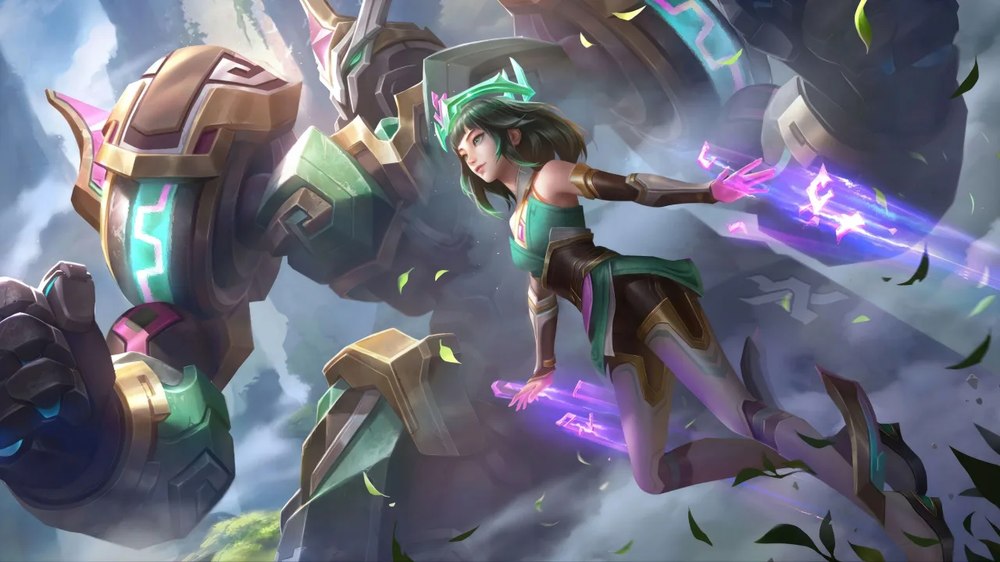

[Edith skins](https://boostmlbb.ru/en/skins/edith.html)

[Skins](https://boostmlbb.ru/en/skins/)/[Edith](https://boostmlbb.ru/en/skins/edith.html)/Ancient Warden

[Edith skin](https://boostmlbb.ru/en/skins/edith.html)

# Ancient Warden

ExceptionalStarLightLimited

How to get

StarLight reward for April 2023.

Released

April 2023

## What the skin changes

-   New look
-   New skill effects
-   Showcase animation
-   Showcase scene
-   Attribute bonus

## All Edith skins [5](https://boostmlbb.ru/en/skins/edith.html)

[Prismatic SentinelExceptional · 2025](https://boostmlbb.ru/en/skins/edith/prismatic-sentinel.html)[Red BastionExquisite · 2024](https://boostmlbb.ru/en/skins/edith/red-bastion.html)[Beyond the Clouds EdithExquisite · 2024](https://boostmlbb.ru/en/skins/edith/beyond-the-clouds-edith.html)[Ancient WardenExceptional · 2023](https://boostmlbb.ru/en/skins/edith/ancient-warden.html)[Celestial SafeguardCommon · 2021](https://boostmlbb.ru/en/skins/edith/celestial-safeguard.html)

## StarLight series

[Tideborn SailorKalea · 2026](https://boostmlbb.ru/en/skins/kalea/tideborn-sailor.html)[Kitsune's ShadowHayabusa · 2026](https://boostmlbb.ru/en/skins/hayabusa/kitsune-s-shadow.html)[Fangs of SlaughterHanzo · 2026](https://boostmlbb.ru/en/skins/hanzo/fangs-of-slaughter.html)[Smoul­dering FortressBelerick · 2026](https://boostmlbb.ru/en/skins/belerick/smouldering-fortress.html)[Magitech WraithObsidia · 2026](https://boostmlbb.ru/en/skins/obsidia/magitech-wraith.html)[Elysian LuminanceZetian · 2026](https://boostmlbb.ru/en/skins/zetian/elysian-luminance.html)[Guardian BattalionHilda · 2026](https://boostmlbb.ru/en/skins/hilda/guardian-battalion.html)[Dreaming KoiHarley · 2026](https://boostmlbb.ru/en/skins/harley/dreaming-koi.html)

**How much is a rank boost on Edith?**Choose your current and target ranks to see the price here.

[Calculate price](https://boostmlbb.ru/en/order.html?type=hero)

## Frequently asked questions

How to get the Ancient Warden skin for Edith?

StarLight reward for April 2023.

When was Ancient Warden released?

April 2023.

What class is Ancient Warden?

Exceptional, StarLight series.
