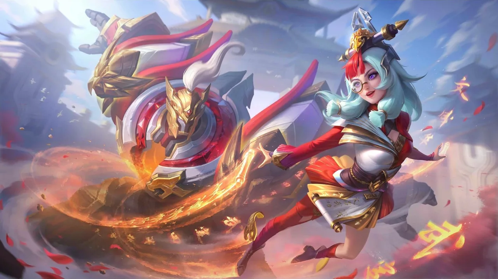

[Tier list](https://boostmlbb.ru/en/heroes/)[Items](https://boostmlbb.ru/en/items/)[Skins](https://boostmlbb.ru/en/skins/)[News & guides](https://boostmlbb.ru/en/news/)

[Skins](https://boostmlbb.ru/en/skins/)/[Edith](https://boostmlbb.ru/en/skins/edith.html)/Red Bastion

[Edith skin](https://boostmlbb.ru/en/skins/edith.html)

# Red Bastion

ExquisiteCollectorLimited

How to get

The top prize of a Collector event draw, paid with diamonds. Limited skins come back in event draws from time to time.

Released

April 2024

## What the skin changes

-   New look
-   New skill effects
-   Skill sounds
-   Voice-over
-   Showcase animation
-   Showcase scene
-   Showcase music
-   Special actions
-   Attribute bonus

## All Edith skins [5](https://boostmlbb.ru/en/skins/edith.html)

[Prismatic SentinelExceptional · 2025](https://boostmlbb.ru/en/skins/edith/prismatic-sentinel.html)[Red BastionExquisite · 2024](https://boostmlbb.ru/en/skins/edith/red-bastion.html)[Beyond the Clouds EdithExquisite · 2024](https://boostmlbb.ru/en/skins/edith/beyond-the-clouds-edith.html)[Ancient WardenExceptional · 2023](https://boostmlbb.ru/en/skins/edith/ancient-warden.html)[Celestial SafeguardCommon · 2021](https://boostmlbb.ru/en/skins/edith/celestial-safeguard.html)

## Collector series

[The PurifierBruno · 2026](https://boostmlbb.ru/en/skins/bruno/the-purifier.html)[Celestial RebelSun · 2026](https://boostmlbb.ru/en/skins/sun/celestial-rebel.html)[Kaiju of the DeepHelcurt · 2026](https://boostmlbb.ru/en/skins/helcurt/kaiju-of-the-deep.html)[Starbound SentryKimmy · 2026](https://boostmlbb.ru/en/skins/kimmy/starbound-sentry.html)[Dreaming MonarchAlice · 2026](https://boostmlbb.ru/en/skins/alice/dreaming-monarch.html)[Tremor of the DeepGrock · 2026](https://boostmlbb.ru/en/skins/grock/tremor-of-the-deep.html)[Celestial GeneralTigreal · 2026](https://boostmlbb.ru/en/skins/tigreal/celestial-general.html)[Sunborn MonarchXavier · 2026](https://boostmlbb.ru/en/skins/xavier/sunborn-monarch.html)

**Rank up on Edith**The calculator shows the price

[Calculate price](https://boostmlbb.ru/en/order.html?type=hero)

## Frequently asked questions

How to get the Red Bastion skin for Edith?

The top prize of a Collector event draw, paid with diamonds. Limited skins come back in event draws from time to time.

When was Red Bastion released?

April 2024.

What class is Red Bastion?

Exquisite, Collector series.
