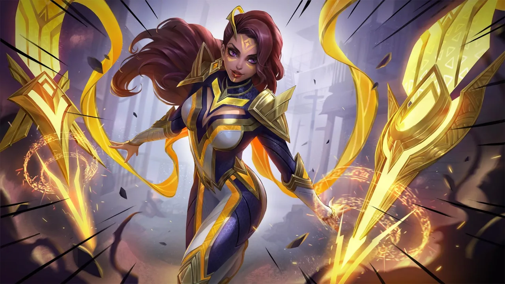
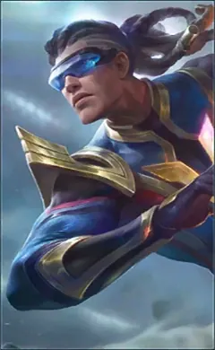

[Tier list](https://boostmlbb.ru/en/heroes/)[Items](https://boostmlbb.ru/en/items/)[Skins](https://boostmlbb.ru/en/skins/)[News & guides](https://boostmlbb.ru/en/news/)

[Skins](https://boostmlbb.ru/en/skins/)/[Esmeralda](https://boostmlbb.ru/en/skins/esmeralda.html)/The Foreseer

[Esmeralda skin](https://boostmlbb.ru/en/skins/esmeralda.html)

# The Foreseer

GrandDawning StarsLimited

How to get

Released in the Dawning Stars event. Limited skins come back in event draws from time to time.

Released

2023

## What the skin changes

-   New look
-   New skill effects
-   Skill sounds
-   Voice-over
-   Showcase animation
-   Showcase scene
-   Attribute bonus

## All Esmeralda skins [8](https://boostmlbb.ru/en/skins/esmeralda.html)

[Astral MuseExceptional · 2025](https://boostmlbb.ru/en/skins/esmeralda/astral-muse.html)[The ForeseerGrand · 2023](https://boostmlbb.ru/en/skins/esmeralda/the-foreseer.html)[Light EnvoyExquisite · 2022](https://boostmlbb.ru/en/skins/esmeralda/light-envoy.html)[Blazing ShadowDeluxe · 2020](https://boostmlbb.ru/en/skins/esmeralda/blazing-shadow.html)[CleopatraExceptional · 2020](https://boostmlbb.ru/en/skins/esmeralda/cleopatra.html)[Lady ThiefExceptional · 2020](https://boostmlbb.ru/en/skins/esmeralda/lady-thief.html)[Poison VineCommon · 2019](https://boostmlbb.ru/en/skins/esmeralda/poison-vine.html)[Ruddy DuskCommon · 2019](https://boostmlbb.ru/en/skins/esmeralda/ruddy-dusk.html)

## Dawning Stars series

[SwordmasterLancelot · 2024](https://boostmlbb.ru/en/skins/lancelot/swordmaster.html)[Blizzard StormVale · 2023](https://boostmlbb.ru/en/skins/vale/blizzard-storm.html)[Thun­derfistChou · 2021](https://boostmlbb.ru/en/skins/chou/thunderfist.html)[FireboltBruno · 2020](https://boostmlbb.ru/en/skins/bruno/firebolt.html)

**Rank up on Esmeralda**The calculator shows the price

[Calculate price](https://boostmlbb.ru/en/order.html?type=hero)

## Frequently asked questions

How to get the The Foreseer skin for Esmeralda?

Released in the Dawning Stars event. Limited skins come back in event draws from time to time.

When was The Foreseer released?

2023.

What class is The Foreseer?

Grand, Dawning Stars series.
