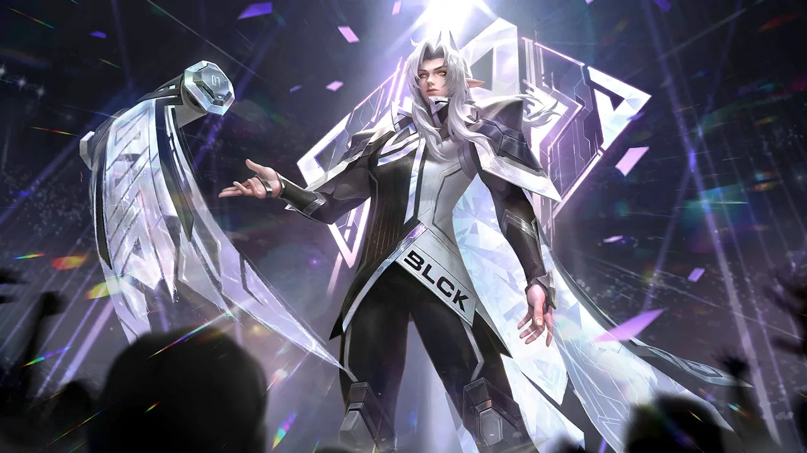
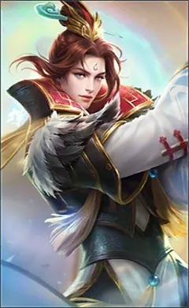
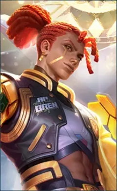

[Tier list](https://boostmlbb.ru/en/heroes/)[Items](https://boostmlbb.ru/en/items/)[Skins](https://boostmlbb.ru/en/skins/)[News & guides](https://boostmlbb.ru/en/news/)

[Skins](https://boostmlbb.ru/en/skins/)/[Estes](https://boostmlbb.ru/en/skins/estes.html)/Blacklist International

[Estes skin](https://boostmlbb.ru/en/skins/estes.html)

# Blacklist International

DeluxeChampionLimited

How to get

Esports skin of Champion: it was released in the tournament event. Limited skins come back in event draws from time to time.

Released

16 March 2024

## What the skin changes

-   New look
-   New skill effects
-   Skill sounds
-   Showcase animation
-   Showcase scene
-   Showcase music
-   Attribute bonus

## All Estes skins [8](https://boostmlbb.ru/en/skins/estes.html)

[Arcane MagistrateExceptional · 2025](https://boostmlbb.ru/en/skins/estes/arcane-magistrate.html)[SPARKLE EstesDeluxe · 2024](https://boostmlbb.ru/en/skins/estes/sparkle-estes.html)[Blacklist Interna­tionalDeluxe · 2024](https://boostmlbb.ru/en/skins/estes/blacklist-international.html)[Crow BishopExceptional · 2020](https://boostmlbb.ru/en/skins/estes/crow-bishop.html)[White CraneCommon · 2018](https://boostmlbb.ru/en/skins/estes/white-crane.html)[Galaxy DominatorExquisite](https://boostmlbb.ru/en/skins/estes/galaxy-dominator.html)[Rattan DragonDeluxe · 2017](https://boostmlbb.ru/en/skins/estes/rattan-dragon.html)[Holy PriestCommon · 2017](https://boostmlbb.ru/en/skins/estes/holy-priest.html)

## Champion series

[EVOS LegendsHarith · 2025](https://boostmlbb.ru/en/skins/harith/evos-legends.html)[APBrenBrody · 2024](https://boostmlbb.ru/en/skins/brody/apbren.html)[ECHOChou · 2023](https://boostmlbb.ru/en/skins/chou/echo.html)[Bren EsportsLancelot · 2020](https://boostmlbb.ru/en/skins/lancelot/bren-esports.html)

**Rank up on Estes**The calculator shows the price

[Calculate price](https://boostmlbb.ru/en/order.html?type=hero)

## Frequently asked questions

How to get the Blacklist International skin for Estes?

Esports skin of Champion: it was released in the tournament event. Limited skins come back in event draws from time to time.

When was Blacklist International released?

16 March 2024.

What class is Blacklist International?

Deluxe, Champion series.
