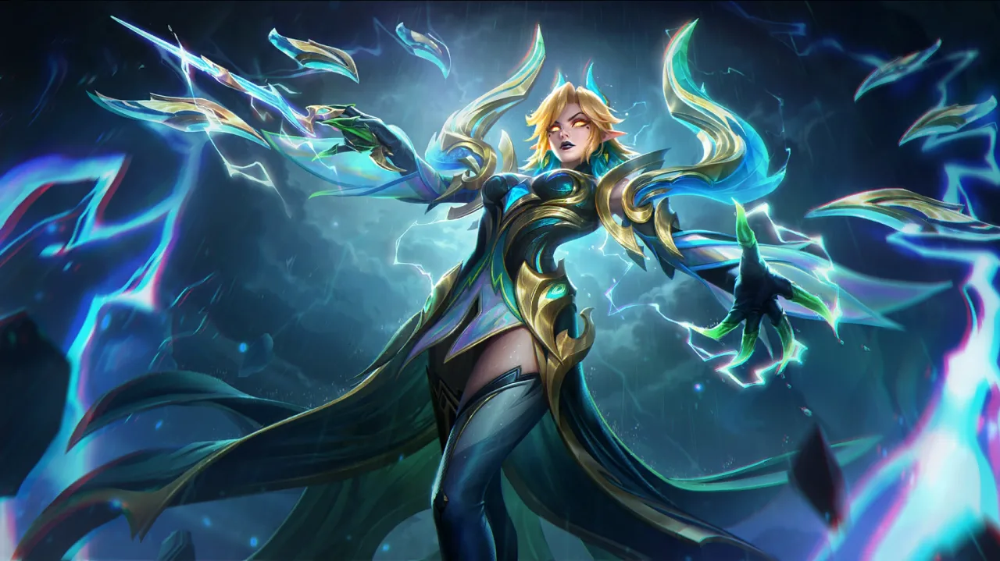

[Tier list](https://boostmlbb.ru/en/heroes/)[Items](https://boostmlbb.ru/en/items/)[Skins](https://boostmlbb.ru/en/skins/)[News & guides](https://boostmlbb.ru/en/news/)

[Skins](https://boostmlbb.ru/en/skins/)/[Eudora](https://boostmlbb.ru/en/skins/eudora.html)/Emerald Enchantress

[Eudora skin](https://boostmlbb.ru/en/skins/eudora.html)

# Emerald Enchantress

ExquisiteLuckyboxLimited

How to get

Came out of Lucky Boxes in events. Limited skins come back in event draws from time to time.

Released

2017

## What the skin changes

-   New look
-   New skill effects
-   Showcase animation
-   Showcase scene
-   Attribute bonus

## All Eudora skins [8](https://boostmlbb.ru/en/skins/eudora.html)

[Midnight's AllureDeluxe · 2026](https://boostmlbb.ru/en/skins/eudora/midnight-s-allure.html)[Atomic Pop EudoraDeluxe · 2023](https://boostmlbb.ru/en/skins/eudora/atomic-pop-eudora.html)[Cosmic VoyageExceptional · 2022](https://boostmlbb.ru/en/skins/eudora/cosmic-voyage.html)[Countess ScarletCommon · 2020](https://boostmlbb.ru/en/skins/eudora/countess-scarlet.html)[Vivo Selfie GoddessExceptional · 2017](https://boostmlbb.ru/en/skins/eudora/vivo-selfie-goddess.html)[Emerald EnchantressExquisite · 2017](https://boostmlbb.ru/en/skins/eudora/emerald-enchantress.html)[Christmas CarnivalExceptional · 2016](https://boostmlbb.ru/en/skins/eudora/christmas-carnival.html)[Flame Red LipsCommon · 2016](https://boostmlbb.ru/en/skins/eudora/flame-red-lips.html)

## Luckybox series

[Lady CraneGuinevere · 2025](https://boostmlbb.ru/en/skins/guinevere/lady-crane.html)[Butterfly SeraphimLunox · 2025](https://boostmlbb.ru/en/skins/lunox/butterfly-seraphim.html)[Mecha DragonClaude · 2025](https://boostmlbb.ru/en/skins/claude/mecha-dragon.html)[Lunar MagicChang'e · 2020](https://boostmlbb.ru/en/skins/change/lunar-magic.html)[Thunder FlashSelena · 2020](https://boostmlbb.ru/en/skins/selena/thunder-flash.html)[RaksheshaHanabi · 2020](https://boostmlbb.ru/en/skins/hanabi/rakshesha.html)[Video-Game DominatorUranus · 2020](https://boostmlbb.ru/en/skins/uranus/video-game-dominator.html)[God of WarMartis · 2020](https://boostmlbb.ru/en/skins/martis/god-of-war.html)

**Rank up on Eudora**The calculator shows the price

[Calculate price](https://boostmlbb.ru/en/order.html?type=hero)

## Frequently asked questions

How to get the Emerald Enchantress skin for Eudora?

Came out of Lucky Boxes in events. Limited skins come back in event draws from time to time.

When was Emerald Enchantress released?

2017.

What class is Emerald Enchantress?

Exquisite, Luckybox series.
