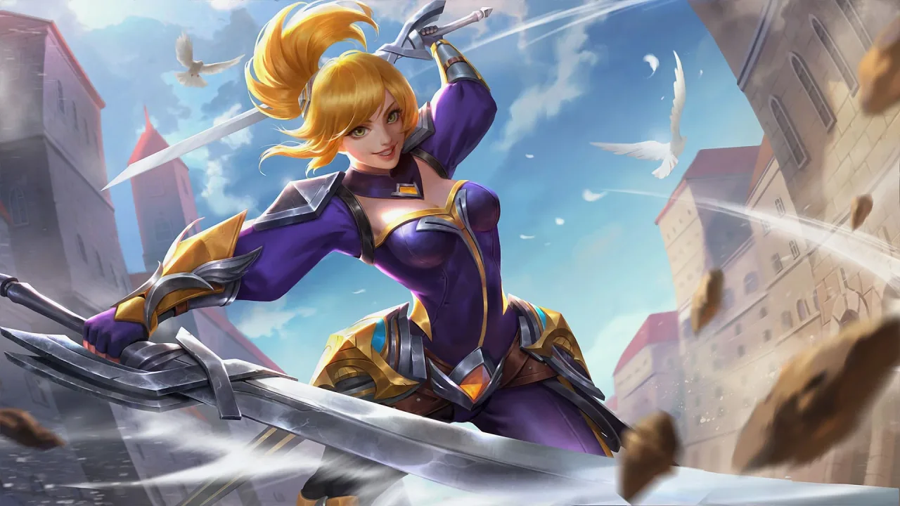

[Tier list](https://boostmlbb.ru/en/heroes/)[Items](https://boostmlbb.ru/en/items/)[Skins](https://boostmlbb.ru/en/skins/)[News & guides](https://boostmlbb.ru/en/news/)

[Skins](https://boostmlbb.ru/en/skins/)/Fanny

# Fanny skins

Skins

13

In the shop

3

Latest

[P.ACE Fanny](https://boostmlbb.ru/en/skins/fanny/p-ace-fanny.html)2025

[Hero profile→](https://boostmlbb.ru/en/heroes/fanny.html)

## All skins

AllGrandExquisiteDeluxeExceptionalCommon

[P.ACE FannyDeluxe · 2025](https://boostmlbb.ru/en/skins/fanny/p-ace-fanny.html)[MikasaGrand · 2023](https://boostmlbb.ru/en/skins/fanny/mikasa.html)[Heart AfloatDeluxe · 2022](https://boostmlbb.ru/en/skins/fanny/heart-afloat.html)[Blade of KibouGrand · 2022](https://boostmlbb.ru/en/skins/fanny/blade-of-kibou.html)[Imperial WarriorCommon · 2021](https://boostmlbb.ru/en/skins/fanny/imperial-warrior.html)[Christmas CarnivalExceptional · 2020](https://boostmlbb.ru/en/skins/fanny/christmas-carnival.html)[Lightborn - RangerDeluxe · 2019](https://boostmlbb.ru/en/skins/fanny/lightborn-ranger.html)[LifeguardExceptional · 2019](https://boostmlbb.ru/en/skins/fanny/lifeguard.html)[Royal CavalryExceptional · 2018](https://boostmlbb.ru/en/skins/fanny/royal-cavalry.html)[SkylarkExquisite · 2018](https://boostmlbb.ru/en/skins/fanny/skylark.html)[Punk PrincessCommon · 2017](https://boostmlbb.ru/en/skins/fanny/punk-princess.html)[Campus YouthCommon · 2016](https://boostmlbb.ru/en/skins/fanny/campus-youth.html)[Galactic Starhawk](https://boostmlbb.ru/en/skins/fanny/galactic-starhawk.html)

**Rank up on Fanny**The calculator shows the price

[Calculate price](https://boostmlbb.ru/en/order.html?type=hero)

## Frequently asked questions

How many skins does Fanny have?

13 skins, the default look not counted. The newest is P.ACE Fanny (9 October 2025).

Which Fanny skins can you buy now?

Lightborn - Ranger (1,089 diamonds), Lifeguard (749 diamonds), Campus Youth (399 diamonds). The other skins were limited and come back only in events.

What is the rarest Fanny skin?

Mikasa, Grand class, Attack on Titan series. Released in the MLBB × Attack on Titan event.
