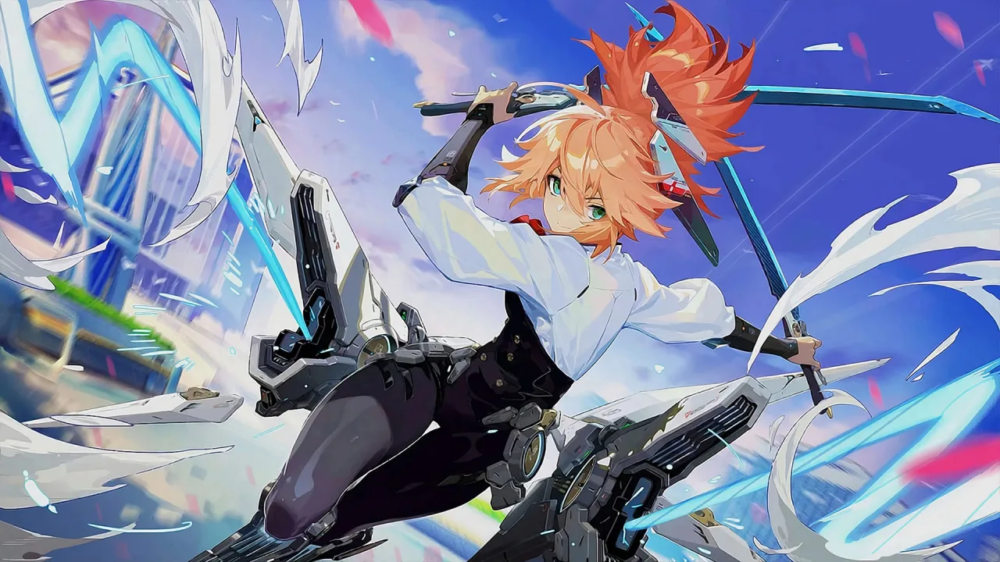

[Tier list](https://boostmlbb.ru/en/heroes/)[Items](https://boostmlbb.ru/en/items/)[Skins](https://boostmlbb.ru/en/skins/)[News & guides](https://boostmlbb.ru/en/news/)

[Skins](https://boostmlbb.ru/en/skins/)/[Fanny](https://boostmlbb.ru/en/skins/fanny.html)/Blade of Kibou

[Fanny skin](https://boostmlbb.ru/en/skins/fanny.html)

# Blade of Kibou

GrandThe AspirantsLimited

How to get

Released in the The Aspirants event. Limited skins come back in event draws from time to time.

Released

22 January 2022

## What the skin changes

-   New look
-   New skill effects
-   Skill sounds
-   Voice-over
-   Skill icons
-   Showcase animation
-   Showcase scene
-   Showcase music
-   Spawn animation
-   Special actions
-   Attribute bonus

## All Fanny skins [13](https://boostmlbb.ru/en/skins/fanny.html)

[P.ACE FannyDeluxe · 2025](https://boostmlbb.ru/en/skins/fanny/p-ace-fanny.html)[MikasaGrand · 2023](https://boostmlbb.ru/en/skins/fanny/mikasa.html)[Heart AfloatDeluxe · 2022](https://boostmlbb.ru/en/skins/fanny/heart-afloat.html)[Blade of KibouGrand · 2022](https://boostmlbb.ru/en/skins/fanny/blade-of-kibou.html)[Imperial WarriorCommon · 2021](https://boostmlbb.ru/en/skins/fanny/imperial-warrior.html)[Christmas CarnivalExceptional · 2020](https://boostmlbb.ru/en/skins/fanny/christmas-carnival.html)[Lightborn - RangerDeluxe · 2019](https://boostmlbb.ru/en/skins/fanny/lightborn-ranger.html)[LifeguardExceptional · 2019](https://boostmlbb.ru/en/skins/fanny/lifeguard.html)[Royal CavalryExceptional · 2018](https://boostmlbb.ru/en/skins/fanny/royal-cavalry.html)[SkylarkExquisite · 2018](https://boostmlbb.ru/en/skins/fanny/skylark.html)[Punk PrincessCommon · 2017](https://boostmlbb.ru/en/skins/fanny/punk-princess.html)[Campus YouthCommon · 2016](https://boostmlbb.ru/en/skins/fanny/campus-youth.html)[Galactic Starhawk](https://boostmlbb.ru/en/skins/fanny/galactic-starhawk.html)

## The Aspirants series

[Silverbolt RaikoSelena · 2026](https://boostmlbb.ru/en/skins/selena/silverbolt-raiko.html)[Imperatrix ArashiObsidia · 2026](https://boostmlbb.ru/en/skins/obsidia/imperatrix-arashi.html)[Daybreak HaloGuinevere · 2025](https://boostmlbb.ru/en/skins/guinevere/daybreak-halo.html)[Twilight StarVexana · 2025](https://boostmlbb.ru/en/skins/vexana/twilight-star.html)[Tech TensaiChang'e · 2024](https://boostmlbb.ru/en/skins/change/tech-tensai.html)[Deadeye SpectreLesley · 2024](https://boostmlbb.ru/en/skins/lesley/deadeye-spectre.html)[Mecha MaidenRuby · 2023](https://boostmlbb.ru/en/skins/ruby/mecha-maiden.html)[Miss HikariLayla · 2022](https://boostmlbb.ru/en/skins/layla/miss-hikari.html)

**Rank up on Fanny**The calculator shows the price

[Calculate price](https://boostmlbb.ru/en/order.html?type=hero)

## Frequently asked questions

How to get the Blade of Kibou skin for Fanny?

Released in the The Aspirants event. Limited skins come back in event draws from time to time.

When was Blade of Kibou released?

22 January 2022.

What class is Blade of Kibou?

Grand, The Aspirants series.
