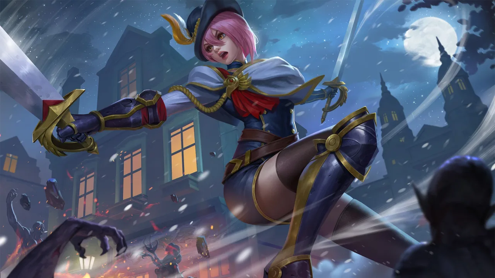

[Tier list](https://boostmlbb.ru/en/heroes/)[Items](https://boostmlbb.ru/en/items/)[Skins](https://boostmlbb.ru/en/skins/)[News & guides](https://boostmlbb.ru/en/news/)

[Skins](https://boostmlbb.ru/en/skins/)/[Fanny](https://boostmlbb.ru/en/skins/fanny.html)/Royal Cavalry

[Fanny skin](https://boostmlbb.ru/en/skins/fanny.html)

# Royal Cavalry

ExceptionalStarLightLimited

How to get

StarLight reward for December 2018.

Released

1 December 2018

## What the skin changes

-   New look
-   New skill effects
-   Showcase animation
-   Attribute bonus

## All Fanny skins [13](https://boostmlbb.ru/en/skins/fanny.html)

[P.ACE FannyDeluxe · 2025](https://boostmlbb.ru/en/skins/fanny/p-ace-fanny.html)[MikasaGrand · 2023](https://boostmlbb.ru/en/skins/fanny/mikasa.html)[Heart AfloatDeluxe · 2022](https://boostmlbb.ru/en/skins/fanny/heart-afloat.html)[Blade of KibouGrand · 2022](https://boostmlbb.ru/en/skins/fanny/blade-of-kibou.html)[Imperial WarriorCommon · 2021](https://boostmlbb.ru/en/skins/fanny/imperial-warrior.html)[Christmas CarnivalExceptional · 2020](https://boostmlbb.ru/en/skins/fanny/christmas-carnival.html)[Lightborn - RangerDeluxe · 2019](https://boostmlbb.ru/en/skins/fanny/lightborn-ranger.html)[LifeguardExceptional · 2019](https://boostmlbb.ru/en/skins/fanny/lifeguard.html)[Royal CavalryExceptional · 2018](https://boostmlbb.ru/en/skins/fanny/royal-cavalry.html)[SkylarkExquisite · 2018](https://boostmlbb.ru/en/skins/fanny/skylark.html)[Punk PrincessCommon · 2017](https://boostmlbb.ru/en/skins/fanny/punk-princess.html)[Campus YouthCommon · 2016](https://boostmlbb.ru/en/skins/fanny/campus-youth.html)[Galactic Starhawk](https://boostmlbb.ru/en/skins/fanny/galactic-starhawk.html)

## StarLight series

[Tideborn SailorKalea · 2026](https://boostmlbb.ru/en/skins/kalea/tideborn-sailor.html)[Kitsune's ShadowHayabusa · 2026](https://boostmlbb.ru/en/skins/hayabusa/kitsune-s-shadow.html)[Fangs of SlaughterHanzo · 2026](https://boostmlbb.ru/en/skins/hanzo/fangs-of-slaughter.html)[Smoul­dering FortressBelerick · 2026](https://boostmlbb.ru/en/skins/belerick/smouldering-fortress.html)[Magitech WraithObsidia · 2026](https://boostmlbb.ru/en/skins/obsidia/magitech-wraith.html)[Elysian LuminanceZetian · 2026](https://boostmlbb.ru/en/skins/zetian/elysian-luminance.html)[Guardian BattalionHilda · 2026](https://boostmlbb.ru/en/skins/hilda/guardian-battalion.html)[Dreaming KoiHarley · 2026](https://boostmlbb.ru/en/skins/harley/dreaming-koi.html)

**Rank up on Fanny**The calculator shows the price

[Calculate price](https://boostmlbb.ru/en/order.html?type=hero)

## Frequently asked questions

How to get the Royal Cavalry skin for Fanny?

StarLight reward for December 2018.

When was Royal Cavalry released?

1 December 2018.

What class is Royal Cavalry?

Exceptional, StarLight series.
