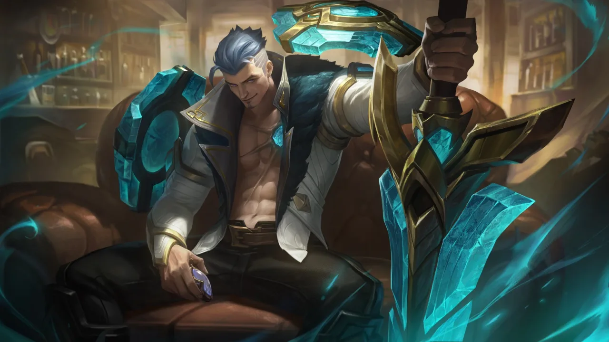

[All skins](https://boostmlbb.ru/en/skins/)

[Skins](https://boostmlbb.ru/en/skins/)/Fredrinn

# Fredrinn skins

Skins

5

In the shop

2

Latest

[Royal Marshal](https://boostmlbb.ru/en/skins/fredrinn/royal-marshal.html)2025

[Hero profile→](https://boostmlbb.ru/en/heroes/fredrinn.html)

## All skins

[Royal MarshalExceptional · 2025](https://boostmlbb.ru/en/skins/fredrinn/royal-marshal.html)[SPARKLE FredrinnDeluxe · 2024](https://boostmlbb.ru/en/skins/fredrinn/sparkle-fredrinn.html)[Neobeast FredrinnGrand · 2023](https://boostmlbb.ru/en/skins/fredrinn/neobeast-fredrinn.html)[Jewel Connois­seurCommon · 2023](https://boostmlbb.ru/en/skins/fredrinn/jewel-connoisseur.html)[Regal RenegadeCommon · 2022](https://boostmlbb.ru/en/skins/fredrinn/regal-renegade.html)

**How much is a rank boost on Fredrinn?**Choose your current and target ranks to see the price here.

[Calculate price](https://boostmlbb.ru/en/order.html?type=hero)

## Frequently asked questions

How many skins does Fredrinn have?

5 skins, the default look not counted. The newest is Royal Marshal (December 2025).

Which Fredrinn skins can you buy now?

Jewel Connoisseur (599 diamonds), Regal Renegade (269 diamonds). The other skins were limited and come back only in events.

What is the rarest Fredrinn skin?

Neobeast Fredrinn, Grand class, Neobeast series. Released in the Neobeast event. Limited skins come back in event draws from time to time.
